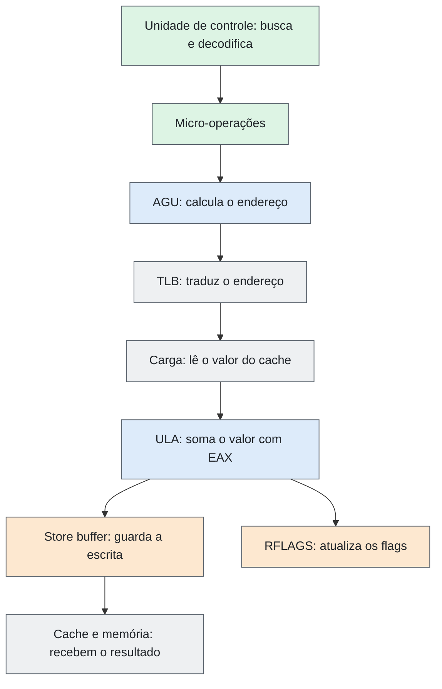

# Processamento em CISC — Unidades, Operações e Paralelismo

| Campo | Descrição |
|---|---|
| **Objeto estudado** | Arquitetura CISC (exemplo: Intel x86/x86-64) |
| **Tema** | Processamento: unidades, operações, registradores, sincronização, paralelismo e limitações |
| **Issues relacionadas** | Não especificadas |
| **Status** | Revisado |

> **Escopo:** o conceito de CISC não é repetido (já tratado em issues anteriores). O texto responde aos nove itens da tarefa sobre o processamento e traz a representação do caminho de uma instrução pelas unidades, com diagrama e exemplo. As fontes estão no final.

## Resumo

Em uma máquina CISC (x86 como exemplo), o processamento é distribuído entre várias unidades: **controle**, **ULA**, **FPU**, **unidades vetoriais**, **AGU** (cálculo de endereços) e **MMU/TLB** (tradução de endereços). As instruções são ricas e aceitam **operandos direto na memória**, então uma única instrução passa por várias unidades em sequência. Os registradores (16 de uso geral no x86-64, além dos de ponto flutuante, vetoriais e de controle) são complementados por um arquivo de registradores físicos usado para renomeação. O paralelismo era pequeno nos CISC antigos e hoje combina **pipeline, superescalar, execução fora de ordem, SIMD, múltiplos núcleos e SMT**. Entre os desafios estão a **decodificação complexa**, o uso de **microcódigo em determinadas instruções**, o **gargalo da memória**, as **dependências** entre instruções e o **consumo de energia**.

## 1. Quais unidades realizam processamento

| Unidade | Função |
|---|---|
| Unidade de controle | Coordena a execução; o decodificador converte instruções em micro-operações e determinadas instruções podem usar microcódigo. |
| ULA (inteiros) | Executa operações aritméticas e lógicas. |
| x87 e unidades vetoriais | Instruções x87 e SSE/AVX podem realizar operações de ponto flutuante; SSE/AVX também permitem operações vetoriais. |
| Unidades vetoriais (SSE/AVX) | Operam sobre vários dados de uma vez. |
| AGU | Calcula o endereço efetivo dos operandos. |
| MMU / TLB | Traduz endereços virtuais em físicos. |

Nos x86 atuais, essas unidades de execução ficam em várias portas, e o decodificador converte as instruções em micro-operações.

## 2. Quais tipos de operações podem realizar

| Categoria | Exemplos |
|---|---|
| Aritméticas | `ADD`, `SUB`, `MUL`, `DIV` |
| Lógicas e de deslocamento | `AND`, `OR`, `XOR`, `NOT`, `SHL`, `SHR` |
| Transferência de dados | `MOV`, `PUSH`, `POP` |
| Controle de fluxo | `JMP`, `Jcc`, `CALL`, `RET` |
| Cadeias de caracteres | `MOVS`, `CMPS` (com prefixo `REP`) |
| Ponto flutuante e vetoriais | Instruções x87, SSE e AVX |
| Atômicas | `LOCK`, `XCHG`, `CMPXCHG` |
| De sistema | `INT`, `HLT` |

**Traço CISC:** muitas dessas instruções aceitam operandos na memória, como em `ADD [mem], EAX`.

## 3. Divisão de responsabilidades entre unidades

| Etapa | Responsável |
|---|---|
| Decodificar e sequenciar | Unidade de controle (com microcódigo nas instruções complexas) |
| Calcular o endereço (`base + índice×escala + deslocamento`) | AGU |
| Traduzir o endereço virtual em físico | TLB |
| Acessar o cache e a memória | Unidade de carga e armazenamento |
| Calcular o resultado | ULA ou FPU |

Uma única instrução CISC, como `ADD [mem], EAX`, pode envolver várias dessas unidades. O diagrama da seção 10 mostra um caminho lógico simplificado; a implementação e a sobreposição das etapas variam conforme o processador.

## 4. Unidades aritméticas, lógicas ou especializadas

| Unidade | Observação |
|---|---|
| ULA de inteiros | Inclui multiplicador e divisor. |
| FPU x87 | Ponto flutuante. |
| Unidades SIMD (SSE/AVX) | Operam vários dados de uma vez (paralelismo de dados). |
| AGU | Específica para endereços. |
| Unidade de desvios | Resolve os desvios condicionais e incondicionais. |
| Instruções especializadas | Por exemplo, as de criptografia AES (AES-NI). |

## 5. Elementos responsáveis por controle

| Elemento | Função |
|---|---|
| Unidade de controle e decodificador | Interpretam as instruções e comandam as demais unidades. |
| Microcódigo | Fornece sequências de micro-operações para determinadas instruções complexas. |
| `RIP` | Contador de programa: aponta a próxima instrução. |
| Registrador de instrução | Guarda a instrução em decodificação. |
| `RFLAGS` | Guarda o resultado de comparações e operações, usado pelos desvios. |
| Preditor de desvios e escalonador de micro-operações | Presentes nos processadores modernos. |
| APIC | Gerencia as interrupções. |

## 6. Registradores ou mecanismos equivalentes

| Tipo | Descrição |
|---|---|
| Uso geral | 16 registradores de 64 bits (`RAX` a `R15`). |
| Controle de fluxo | `RIP` e `RFLAGS`. |
| Segmento | Registradores de segmento. |
| Ponto flutuante | Registradores x87. |
| Vetoriais | `XMM`, `YMM` e `ZMM`. |
| Controle do sistema | `CR0`, `CR3`… |
| Registradores físicos | Arquivo interno maior que o visível ao programa, usado para renomeação. |

**Traço CISC:** algumas instruções podem operar diretamente sobre operandos na memória, evitando instruções explícitas de transferência em determinados casos. Memória e cache, porém, não têm a mesma velocidade nem a mesma função que os registradores.

## 7. Sincronização

| Mecanismo | Uso |
|---|---|
| Clock | Sincroniza as unidades internas. |
| Aposentadoria em ordem | Em processadores que usam esse mecanismo, instruções podem ser executadas fora de ordem, mas seus resultados arquiteturais são confirmados na ordem do programa. |
| `LOCK` e `XCHG` | Operações atômicas entre núcleos. |
| Barreiras de memória | `MFENCE`, `LFENCE` e `SFENCE`. |
| Coerência de cache | Mantém os dados consistentes entre os núcleos. |

## 8. Paralelismo, quando existente

| Nível | Descrição |
|---|---|
| CISC antigos | Paralelismo pequeno. O VAX-11/780, por exemplo, tinha pipeline de três estágios. |
| Pipeline | Várias instruções em etapas diferentes ao mesmo tempo. |
| Superescalar | Várias instruções por ciclo. |
| Execução fora de ordem | As instruções são executadas conforme a disponibilidade dos dados. |
| SIMD | Paralelismo de dados, com uma instrução sobre vários valores. |
| Múltiplos núcleos | Paralelismo de tarefas. |
| SMT | Multithreading simultâneo (por exemplo, Hyper-Threading). |

## 9. Principais limitações do processamento

- **Decodificação complexa:** instruções de tamanho variável (de 1 a 15 bytes no x86) tornam a decodificação custosa.
- **Microcódigo e ciclos variáveis:** instruções complexas levam um número variável de ciclos e exigem microcódigo, o que dificulta o pipeline.
- **Gargalo da memória:** uma só instrução pode gerar vários acessos à memória, e a diferença de velocidade entre CPU e memória continua sendo o gargalo central.
- **Dependências:** dependências de dados e desvios limitam o paralelismo entre instruções.
- **Consumo de energia:** o hardware de decodificação e de execução fora de ordem é complexo e consome mais energia.
- **Coerência entre núcleos:** em vários núcleos, a coerência de cache acrescenta latência.

## 10. Representação: caminho de uma instrução pelas unidades

**Figura 1 — Caminho de `ADD [mem], EAX` no x86-64**



### 10.1 Exemplo — soma de um registrador a um valor da memória

```nasm
        add   dword [rbx + rcx*4 + 8], eax
```

**O que essa instrução faz?**

Ela lê um valor da memória, soma com o conteúdo de EAX e grava o resultado de volta no mesmo endereço.

1. **Decodificação:** a unidade de controle decodifica a instrução em micro-operações.
2. **Endereço:** a AGU combina RBX, RCX multiplicado por 4 e o deslocamento 8.
3. **Leitura:** o TLB traduz o endereço e o valor é lido do cache (ou dos níveis seguintes, se não estiver lá).
4. **Soma:** a ULA soma o valor lido com EAX e os flags são atualizados em `RFLAGS`.
5. **Escrita:** o resultado passa pelo *store buffer* e é encaminhado ao cache.

**Em resumo:** a instrução realiza uma leitura e uma escrita lógica de dados no mesmo endereço, usando cálculo de endereço, tradução, hierarquia de memória e unidade aritmética. O valor de EAX é usado na soma, mas não é alterado. O diagrama é didático e não representa todos os detalhes internos nem a temporização real do processador.

## Checklist da entrega

- [x] Quais unidades realizam processamento (seção 1)
- [x] Quais tipos de operações podem realizar (seção 2)
- [x] Divisão de responsabilidades entre unidades (seção 3)
- [x] Unidades aritméticas, lógicas ou especializadas (seção 4)
- [x] Elementos responsáveis por controle (seção 5)
- [x] Registradores ou mecanismos equivalentes (seção 6)
- [x] Sincronização (seção 7)
- [x] Paralelismo, quando existente (seção 8)
- [x] Principais limitações do processamento (seção 9)
- [x] Representação do caminho da instrução, com diagrama e exemplo (seção 10)
- [x] Fontes com link (abaixo)

## Fontes

| # | Referência | Usada em |
|---|---|---|
| 1 | Intel. *Intel 64 and IA-32 Architectures Software Developer’s Manual*. [Link](https://www.intel.com/content/www/us/en/developer/articles/technical/intel-sdm.html) | Seções 1 a 7, 9 e 10 |
| 2 | EMER, J. S.; CLARK, D. W. *A Characterization of Processor Performance in the VAX-11/780*. ISCA, 1984. [Link](https://people.csail.mit.edu/emer/media/papers/1984.05.isca.vax.pdf) | Seção 8 |

> **Nota:** os exemplos usam x86/x86-64 e os detalhes (portas de execução, SMT, instruções disponíveis) variam por modelo. Conferir página e edição exata das fontes antes da versão final.
