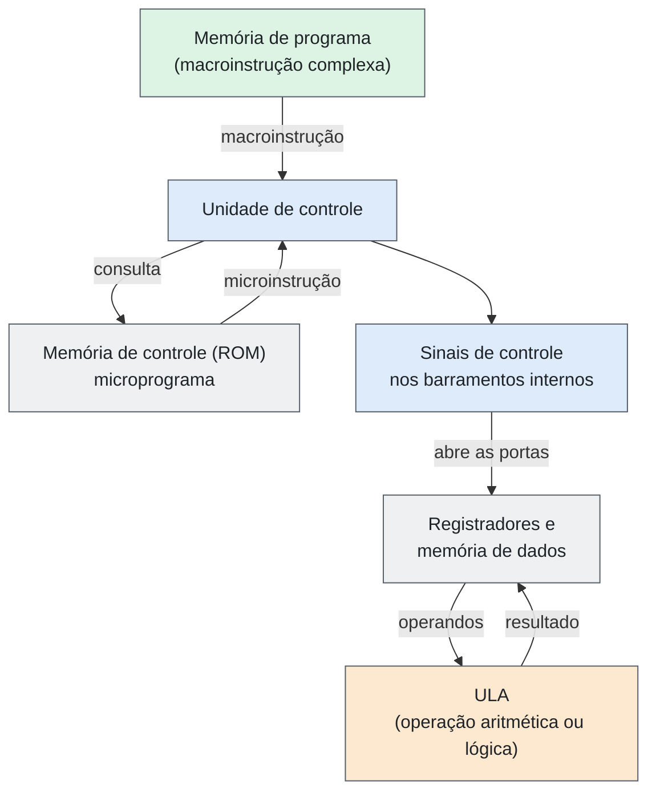
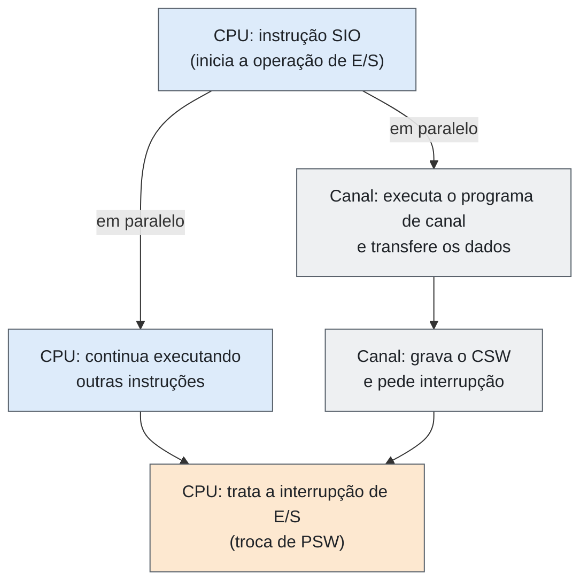
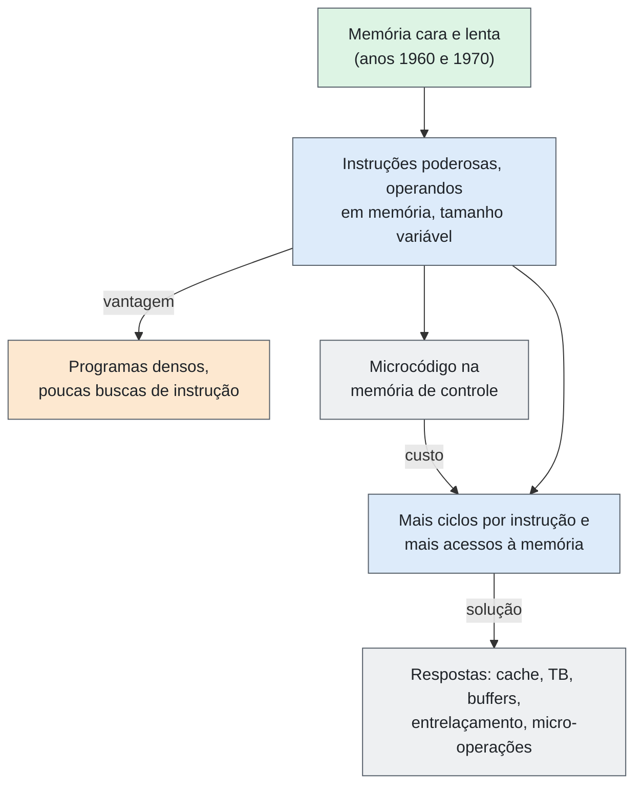

# Entrega 08 — Integração, Limitações e Desempenho

| Campo | Descrição |
|---|---|
| **Objeto estudado** | Arquitetura CISC (exemplos: IBM System/360 Model 85, DEC VAX-11/780, Intel x86/x86-64) |
| **Entrega** | 08 — Integração, Limitações e Desempenho |
---
## Resumo

A arquitetura CISC se baseia na **microprogramação**: instruções complexas, com operandos diretamente na memória, são executadas como sequências de passos simples. Isso gera programas densos e poucas buscas de instrução, o que era vantagem quando a memória era cara e lenta. O custo é **mais ciclos por instrução** e **mais acessos à memória**. As soluções historicamente adotadas para esse custo foram o **cache** (System/360 Model 85), o **buffer de instruções, a TB e o buffer de escrita** (VAX-11/780) e a **tradução em micro-operações com execução fora de ordem** (x86). A característica que mais influencia o trabalho dessas máquinas é o **modelo de instruções complexas que operam sobre a memória**, justificado na seção 12.
---
## 1. Como os principais componentes trabalham conjuntamente

A arquitetura CISC se baseia na microprogramação: instruções complexas (macroinstruções) são executadas como sequências de passos simples (microinstruções), controlados por um microprograma. Os componentes a seguir seguem o modelo didático das aulas. No modelo, o microprograma completo tem 79 microinstruções, e a leitura e a escrita de memória levam dois ciclos.

1. **Memória de programa e unidade de controle:** a memória fornece a macroinstrução complexa (por exemplo, multiplicar valores direto da memória). A unidade de controle atua como “maestro”: em vez de executar a instrução por fiação rígida, consulta uma ROM (memória de controle) que guarda o microprograma. Esse microprograma divide a instrução em microinstruções mais simples, em sequência.
2. **Barramentos e sinais de controle:** para cada microinstrução, a unidade de controle gera sinais que abrem e fecham as “portas” dos barramentos internos (como os barramentos A e B), definindo para onde os dados vão a cada ciclo. Por isso, em geral, uma única instrução CISC exige vários ciclos de clock.
3. **Registradores e memória de dados:** o CISC usa poucos registradores (de 6 a 16 no modelo; 16 no System/360, no VAX e no x86-64), com funções específicas em parte deles. Como são limitados, a arquitetura interage bastante com a memória de dados, com leituras e escritas durante a execução da própria instrução.
4. **ULA (unidade lógica e aritmética):** depois que os sinais de controle posicionam os dados (vindos dos registradores ou da memória) nas entradas, a ULA executa a operação aritmética ou lógica.

**Fluxo resumido:** memória de programa → unidade de controle (consulta a ROM de microprograma) → sinais de controle nos barramentos → registradores e memória de dados → ULA.

**Figura 1 — Fluxo da execução microprogramada (modelo didático)**



> **Observação:** o modelo trata memória de programa e memória de dados separadamente, por clareza. No System/360, no VAX e no x86 há uma única memória para instruções e dados (o x86 separa instruções e dados apenas nos caches L1).
---
## 2. Características que favorecem o funcionamento

- **Alta densidade de código:** uma única macroinstrução faz várias tarefas (carregar da memória, somar e salvar), então os programas ocupam menos espaço na RAM. Isso reduz o tráfego no barramento durante a busca de instruções e permite rodar programas complexos em sistemas com pouca memória.
- **Unidade de controle microprogramada:** como a execução depende de microprogramas guardados em uma memória de controle, é mais simples corrigir, atualizar ou expandir o conjunto de instruções do que refazer circuitos de fiação rígida. Nos x86 atuais, parte do microcódigo pode ser atualizada na inicialização. A microprogramação também permitiu a compatibilidade entre modelos do System/360.
- **Modos de endereçamento ricos:** o hardware suporta ponteiros, deslocamentos e índices complexos e resolve o endereçamento na própria instrução. O compilador gera menos instruções, e o trabalho em Assembly fica mais fácil.
- **Hierarquia de memória (cache):** como as instruções levam vários ciclos e acessam muito a memória de dados, o cache próximo ao núcleo reduz as esperas e evita que o processador fique ocioso aguardando a RAM. Ele não é exclusivo do CISC, mas é essencial para compensar o custo de acesso à memória desse modelo.
- **Compatibilidade a longo prazo:** o software legado continua funcionando em máquinas novas, seja por microprogramas, seja por decodificadores que traduzem as instruções antigas (como na evolução do x86). Isso favorece a estabilidade do ecossistema de software.
- **E/S desacoplada da CPU:** no System/360, os canais executam programas de canal sozinhos, e a CPU continua trabalhando.
---
## 3. Principais limitações

- **Pipeline e paralelismo:** as instruções têm tamanho variável e levam números diferentes de ciclos, o que dificulta um pipeline eficiente. Uma instrução complexa e demorada atrasa as seguintes. No VAX-11/780, a decodificação da instrução seguinte só começava depois que a anterior terminava.
- **Complexidade de hardware e área de chip:** a unidade de controle precisa de circuitos grandes para decodificar as macroinstruções e gerenciar o microprograma. Parte do conjunto de instruções é pouco usada pelos programas e compiladores, de modo que existe área dedicada a circuitos raramente ativados, o que encarece o projeto e a fabricação.
- **Energia e calor:** decodificar instruções complexas em várias microinstruções consome energia e gera calor. Isso historicamente limitou o CISC em dispositivos móveis e a bateria. Estudos recentes indicam que, nos x86 atuais, a diferença causada pela ISA é pequena em relação à microarquitetura.
- **Mais acessos à memória:** instruções que operam direto na memória e modos de endereçamento complexos geram vários acessos por instrução. Como a memória (cache ou RAM) é mais lenta que o processador, o processador espera pelo barramento quando o dado não está no cache.
- **Poucos registradores:** só 16 registradores, o que aumenta o tráfego com a memória.
---
## 4. Gargalos

| Gargalo | Descrição | Evidência |
|---|---|---|
| Decodificação (estágio Decode) | As instruções têm comprimento variável e vários formatos. O processador só descobre onde uma instrução termina depois de lê-la, então a decodificação gasta tempo e muita lógica só para separar os comandos. | x86: de 1 a 15 bytes. System/360: 2, 4 ou 6 bytes. VAX: média de 3,8 bytes. |
| Memória (*memory wall*) | Uma única instrução pode ler, modificar e gravar dados na memória, que é bem mais lenta que o processador. O chip fica ocioso esperando os dados. | Model 85: memória cerca de 13 vezes mais lenta (1,04 µs contra 80 ns). VAX-11/780: cerca de 20% do tempo em esperas. |
| Pipeline (bolhas e *hazards*) | Como cada instrução leva um número variável de ciclos, o pipeline perde o sincronismo. Instruções demoradas travam as simples que vêm atrás. | VAX-11/780: `CALL` e `RET` geram esperas de escrita por causa do cache write-through. |
| Energia e calor (*power wall*) | Circuitos grandes de decodificação e de microprogramação consomem energia por ciclo e limitam o aumento do clock sem dissipação eficiente. O problema vale para processadores em geral, e o peso específico do CISC hoje é pequeno. | Estudos recentes sobre x86 e ARM. |
| Tradução de endereços | Tabelas de páginas lidas na memória falham no cache com frequência. | VAX-11/780: 0,029 faltas de TB por instrução, cerca de 21,6 ciclos por falta. |
| Barramentos e canais | Canal seletor atende uma operação por vez; UNIBUS limitado em vazão. | UNIBUS do VAX-11/780: 1,5 MB/s agregados. |
---
## 5. Fatores que influenciam o desempenho

O tempo de execução depende de **número de instruções × ciclos por instrução (CPI) × duração do ciclo**. O CISC reduz o primeiro fator e aumenta o segundo.

| Fator | Efeito |
|---|---|
| CPI e microprograma | Instruções complexas viram várias microinstruções e levam mais ciclos. |
| Clock | É limitado pela decodificação complexa, pelo consumo de energia e pelo calor. |
| Decodificação e pipeline | Instruções de tamanho e duração variáveis geram atrasos, bolhas e *stalls*. |
| Memória e cache | A RAM é lenta, então um bom cache reduz as esperas. |
| Densidade de código | Programas menores geram menos tráfego no barramento. |
| Compilador | Escolher as instruções mais eficientes é decisivo, e a mais complexa nem sempre é a mais rápida. |
| Paralelismo (x86 moderno) | Micro-operações, execução fora de ordem e predição de desvios compensam boa parte das limitações. |
| Carga de trabalho | As medições do VAX-11/780 foram feitas sob VMS com 15 a 40 usuários em *time-sharing*. Outra carga daria outros números. |

**Exemplo de custo de memória no VAX-11/780.** A instrução abaixo gera dois acessos de leitura a dados. Em média, uma instrução do VAX faz 0,78 leitura e 0,41 escrita de dados, e o buffer de instruções faz cerca de 2,2 referências ao cache por instrução, o que dá cerca de 3,4 referências ao cache por instrução média.

```asm
        ADDL3  (R1)+, 8(R2), R3    R3 = mem[R1] + mem[R2 + 8]; R1 = R1 + 4
```
---
## 6. Capacidade de processamento

O System/360 Model 85 foi desenvolvido para oferecer alto desempenho. O processador tinha ciclo de 80 nanossegundos e trabalhava internamente com palavras de 16 bytes, transferindo essa quantidade de dados em uma única solicitação. Um cache integrado ao processador guardava os dados mais usados e reduzia o tempo de acesso. Nos estudos apresentados, o sistema alcançou, em média, **81% do desempenho de um sistema teórico ideal** (toda a memória na velocidade do cache), o que mostra a contribuição da hierarquia de memória.

| Máquina | Ciclo | Medida disponível | Cuidado na comparação |
|---|---|---|---|
| System/360 Model 85 | 80 ns (memória: 1,04 µs) | Cache atende 1 pedido por ciclo. Desempenho médio de 81% do ideal. | Medir contra o ideal da própria máquina, não contra CPUs atuais. |
| VAX-11/780 | 200 ns (ciclo da EBOX) | 10,6 ciclos por instrução, ou cerca de 2,1 µs. Equivale a cerca de 0,47 milhão de instruções por segundo (cálculo próprio). | Valor medido sob carga de *time-sharing*; vale para essa carga. |
| x86-64 | Varia por modelo | Executa mais de uma micro-operação por ciclo (superescalar, fora de ordem). | Não há um número único. Depende do modelo e da carga. |

Para comparar sem usar só velocidade absoluta, usam-se medidas internas, como ciclos por instrução, fração do tempo gasta em esperas e taxa de acerto do cache. **Onde o tempo vai em uma instrução média do VAX-11/780** (percentuais calculados sobre 10,593 ciclos):

| Categoria | Ciclos por instrução | Parcela |
|---|---|---|
| Computação (sem acesso à memória) | 7,267 | 68,6% |
| Leitura de dados | 0,783 | 7,4% |
| Espera de leitura | 0,964 | 9,1% |
| Escrita de dados | 0,409 | 3,9% |
| Espera de escrita | 0,450 | 4,2% |
| Espera por bytes do buffer de instruções | 0,720 | 6,8% |
| **Total** | **10,593** | **100%** |
---
## 7. Comunicação

No VAX-11/780, os principais componentes se comunicam pelo **SBI** (*Synchronous Backplane Interconnect*), que liga a CPU, a memória principal e o subsistema de entrada e saída. Essa estrutura permite a troca de instruções, dados e solicitações entre as unidades. Os periféricos se conectam por interfaces específicas: o **MASSBUS** liga dispositivos de armazenamento, como discos e fitas, e o **UNIBUS** liga periféricos e dispositivos de E/S.

O compartilhamento dos mecanismos de comunicação gera limitações quando vários componentes pedem acesso ao mesmo tempo. Nesses casos, é preciso controlar o acesso ao barramento para evitar conflitos. A velocidade de transferência entre CPU e memória também pode limitar o desempenho, mesmo quando o processador poderia executar mais rápido. O desempenho depende, portanto, da CPU, da eficiência da comunicação entre os componentes, da velocidade da memória e da disponibilidade das interconexões.

| Arquitetura | Como as partes se comunicam |
|---|---|
| System/360 | CPU e dispositivos se comunicam por **canais** (seletor e multiplexador). O programa descreve a operação em CCWs. O canal avisa o fim por **interrupção** e registra o estado no CSW. No Model 85, os canais leem direto da memória principal e suas escritas atualizam o cache se o dado estiver presente. |
| VAX-11/780 | Barramento interno **SBI**; adaptadores para **UNIBUS** e **MASSBUS**; console LSI-11. Taxa agregada máxima do UNIBUS: 1,5 MB/s. |
| x86-64 | Portas de E/S, registradores mapeados em memória, **DMA** e **interrupções** (APIC/MSI). O DMA normalmente é coerente com os caches. |
---
## 8. Armazenamento

O armazenamento é organizado em níveis: **registradores** (16 no System/360, no VAX e no x86-64), **memória principal** (programas, dados, pilha e tabelas) e **armazenamento externo** (disco e fita). Como as instruções podem usar operandos na memória, o desempenho depende de como a memória é acessada.

| Máquina | Níveis e capacidades |
|---|---|
| System/360 Model 85 | Registradores, cache de **16 KiB** (opcionalmente 24 ou 32 KiB, em setores de 1 KiB e blocos de 64 bytes) e memória principal de **512 KiB a 4 MiB** (ciclo de 1,04 µs). Probabilidade média de acerto no cache: **0,968**. |
| VAX-11/780 | Registradores, buffer de instruções de **8 bytes**, **TB** e **cache**, buffer de escrita de **4 bytes** e memória principal pelo SBI. |
| x86-64 | Registradores, **L1**, **L2**, **L3** e DRAM, com TLBs, cache de micro-operações e *store buffer*. |

O **microcódigo** é outro elemento de armazenamento próprio do CISC: fica em uma memória de controle dentro da CPU, e nos x86 atuais parte dele pode ser atualizada na inicialização. O espaço de endereçamento cresceu com as gerações: 24 bits no System/360 (16 MiB), 32 bits virtuais no VAX (4 GiB) e 48 ou 57 bits virtuais no x86-64.
---
## 9. Paralelismo

O paralelismo nas máquinas CISC aparece em níveis diferentes, conforme a época.

- **System/360:** o paralelismo mais claro é entre CPU e E/S. Depois da instrução `SIO`, a CPU continua executando enquanto o canal trabalha (figura 2). O Model 85 também sobrepunha acessos ao cache (um pedido por ciclo) e usava memória entrelaçada em 4 vias.
- **VAX-11/780:** pipeline de três estágios (busca, decodificação e execução microcodificada), com paralelismo limitado: a decodificação seguinte só começava depois que a anterior terminava, e só a EBOX escrevia dados.
- **x86 atual:** a instrução CISC é traduzida em micro-operações, o que permite execução superescalar e fora de ordem, renomeação de registradores e predição de desvios. Há ainda paralelismo de dados (SIMD) e entre núcleos, com protocolos de coerência de cache.

**Figura 2 — Paralelismo entre CPU e canal no System/360**



Em resumo, instruções complexas e de tamanho variável dificultam o paralelismo, porque complicam a decodificação e criam dependências de memória. A solução moderna foi esconder o CISC atrás de micro-operações simples.
---
## 10. Decisões arquiteturais importantes

| Decisão | Vantagem | Custo ou limitação |
|---|---|---|
| Separar arquitetura e implementação (System/360) | Família compatível, de preços e velocidades diferentes | Modelos pequenos precisam emular em microcódigo o que modelos grandes fazem em hardware |
| Uso geral, com ênfase em E/S | Atende trabalho científico e comercial; canais | Complexidade do subsistema de E/S |
| 16 registradores e endereçamento base + índice + deslocamento | Código compacto; dois registradores em um byte | Poucos registradores, mais acessos à memória |
| Instruções poderosas com operandos em memória | Programas densos, poucas buscas de instrução | Mais ciclos por instrução; vários acessos à memória por instrução |
| Memória virtual e especificadores regulares (VAX) | Programação e compiladores mais simples | Mais trabalho para microcódigo e tabelas de tradução |
| Cache transparente ao programa (Model 85) | Ganho de desempenho sem quebrar a compatibilidade | Hardware adicional; falhas de cache causam esperas |
| Manter a interface CISC e executar micro-operações (x86) | Compatibilidade de software e uso de técnicas modernas | Custo de decodificação e de energia |
---
## 11. Contexto tecnológico: o sistema era adequado à função?

| Máquina | Função de projeto | Adequação (evidência) |
|---|---|---|
| System/360 | Família única de uso geral, para trabalho científico e comercial | Atendeu ao objetivo de compatibilidade entre modelos e de forte E/S. O Model 85 mostrou como ganhar desempenho com cache sem alterar a arquitetura. |
| VAX-11/780 | Minicomputador de 32 bits para *time-sharing* | As medições foram feitas com cargas de 15 a 40 usuários sob VMS, a função para a qual foi projetado. O custo foi o número de ciclos por instrução. |
| x86-64 | Compatibilidade com o software existente em PCs e servidores | Mantém a interface e usa micro-operações por dentro. Estudos recentes indicam que a diferença de ISA tem pouco peso hoje. |

Um estudo de 1991 comparou um VAX e um MIPS com organização de hardware semelhante e concluiu que o MIPS era entre 2 e 4 vezes mais rápido (média de 2,7). O resultado vale para essa comparação específica e mostra o custo da complexidade do conjunto de instruções, mas não diz que o VAX era inadequado ao seu tempo, quando a memória era cara e os compiladores eram menos sofisticados.

## 12. Questão central

**Qual característica do CISC mais influencia sua capacidade de realizar o trabalho para o qual foi projetado?**

A característica que mais influencia é o **modelo de instruções complexas que operam diretamente sobre a memória, executadas por microcódigo**. Quatro razões técnicas sustentam a resposta:

1. **Define o tamanho e a densidade do código.** Menos instruções e menos bytes buscados eram vantagem quando a memória era cara e lenta.
2. **Define o número de acessos à memória por instrução.** No VAX-11/780, cada instrução média faz 0,78 leitura e 0,41 escrita de dados, além de cerca de 2,2 referências do buffer de instruções ao cache.
3. **Define os ciclos por instrução.** O microcódigo e as esperas de memória levam a 10,6 ciclos por instrução, dos quais cerca de 20% são espera.
4. **Explica as outras decisões.** Cache, TB, buffers de escrita, entrelaçamento e micro-operações existem para reduzir o custo desse modelo (figura 3).

**Figura 3 — Da decisão central às respostas arquiteturais**


---
## Fontes

| # | Referência | Usada em |
|---|---|---|
| 1 | SONG, S. W. *MAC0344 2021 Aula 23 — CISC Microprogramação*. e-Aulas USP. [Link](https://eaulas.usp.br/portal/video?idItem=32750) | Seções 1 a 5 |
| 2 | SONG, S. W. *MAC0344 2021 Aula 24 — CISC Microprogramação*. e-Aulas USP. [Link](https://eaulas.usp.br/portal/video?idItem=32814) | Seções 1 a 5 |
| 3 | SONG, S. W. *MAC0344 2021 Aula 25 — CISC Microprogramação*. e-Aulas USP. [Link](https://eaulas.usp.br/portal/video?idItem=32958) | Seções 1 a 5 |
| 4 | SONG, S. W. *MAC0344 2021 Aula 26 — CISC Microprogramação*. e-Aulas USP. [Link](https://eaulas.usp.br/portal/video?idItem=33039) | Seções 1 a 5 |
| 5 | DEC. *VAX-11/780 Hardware User’s Guide* (EK-11780-UG-001, 1979), cap. 1, seções 1.3.1 a 1.3.3. [Link](https://mirrorservice.org/sites/www.bitsavers.org/pdf/dec/vax/780/EK-11780-UG-001_VAX-11_780_Hardware_Users_Guide_197902.pdf) | Seções 7, 8 |
| 6 | AMDAHL, G. M.; BLAAUW, G. A.; BROOKS, F. P. *Architecture of the IBM System/360*. IBM Journal of R&D, 1964. [Link](https://www.ece.ucdavis.edu/~vojin/CLASSES/EEC272/S2005/Papers/IBM360-Amdahl_april64.pdf) | Seções 2, 10, 11 |
| 7 | LIPTAY, J. S. *Structural aspects of the System/360 Model 85, II: The cache*. IBM Systems Journal, 1968. [Link](https://www.andrew.cmu.edu/course/15-440-sp15/assets/READINGS/liptay1968.pdf) | Seções 2, 4, 6, 7, 8, 9, 10, 11 |
| 8 | EMER, J. S.; CLARK, D. W. *A Characterization of Processor Performance in the VAX-11/780*. ISCA, 1984. [Link](https://people.csail.mit.edu/emer/media/papers/1984.05.isca.vax.pdf) | Seções 3, 4, 5, 6, 8, 9, 11, 12 |
| 9 | BHANDARKAR, D.; CLARK, D. W. *Performance from Architecture: Comparing a RISC and a CISC with Similar Hardware Organization*. ASPLOS, 1991. [Link](https://doi.org/10.1145/106972.107003) | Seções 5, 11 |
| 10 | PATTERSON, D. A.; DITZEL, D. R. *The Case for the Reduced Instruction Set Computer*. SIGARCH, 1980. [Link](https://cs.utexas.edu/~fussell/courses/cs352h/papers/risc.pdf) | Seções 10, 11, 12 |
| 11 | IBM. *System/360 Principles of Operation* (A22-6821). [Link](https://ftp.mirrorservice.org/sites/www.bitsavers.org/pdf/ibm/360/princOps/A22-6821-6_360PrincOpsJan67.pdf) | Seções 2, 7, 8, 9 |
| 12 | DEC. *VAX Architecture Handbook* (1981). [Link](https://50anni.informatica.unisa.it/wp-content/uploads/2023/02/02-VAX-architecture-handbook-1981.pdf) | Seções 2, 8, 10 |
| 13 | Datapro. *DEC VAX-11/780* (1978). [Link](https://ftp.mirrorservice.org/sites/www.bitsavers.org/pdf/datapro/datapro_reports_70s-90s/DEC/M11-384-40_7805_DEC_VAX-11_780.pdf) | Seções 4, 7 |
| 14 | Intel. *Intel 64 and IA-32 Architectures Software Developer’s Manual*. [Link](https://www.intel.com/content/www/us/en/developer/articles/technical/intel-sdm.html) | Seções 2, 7, 8, 9 |
| 15 | DREPPER, U. *What Every Programmer Should Know About Memory*. 2007. [Link](http://www.akkadia.org/drepper/cpumemory.pdf) | Seções 4, 8, 9 |
| 16 | FOG, A. *The microarchitecture of Intel, AMD and VIA CPUs*. [Link](https://www.agner.org/optimize/microarchitecture.pdf) | Seções 4, 6, 9 |
| 17 | BLEM, E.; MENON, J.; SANKARALINGAM, K. *Power Struggles: Revisiting the RISC vs. CISC Debate*. HPCA, 2013. [Link](https://courses.cs.washington.edu/courses/cse470/17sp/readings/RISC_CISC_1.pdf) | Seções 11, 12 |
| 18 | University of Edinburgh. *Two-address systems: IBM System/360 and /370*. [Link](https://homepages.inf.ed.ac.uk/rni/comp-arch/Instr/2-addr.html) | Seção 2 |
