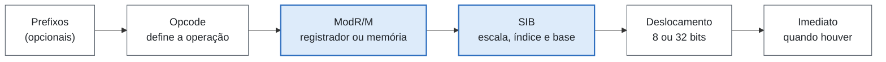
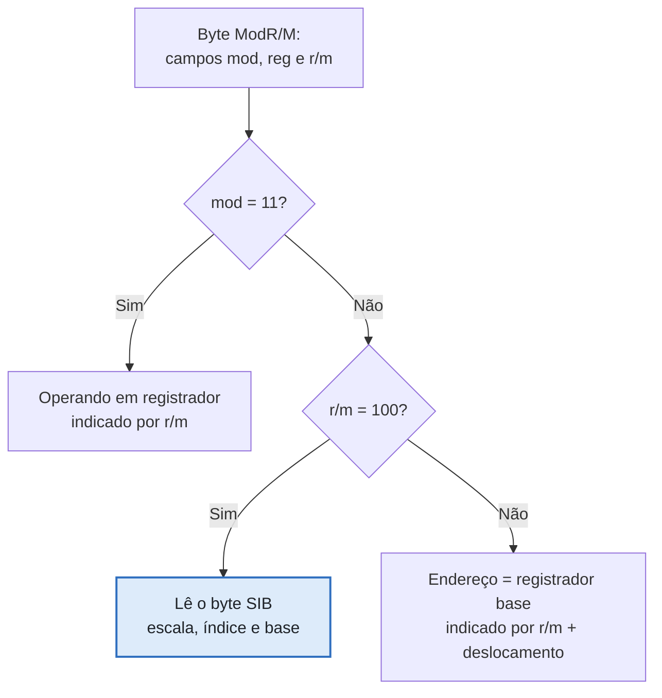
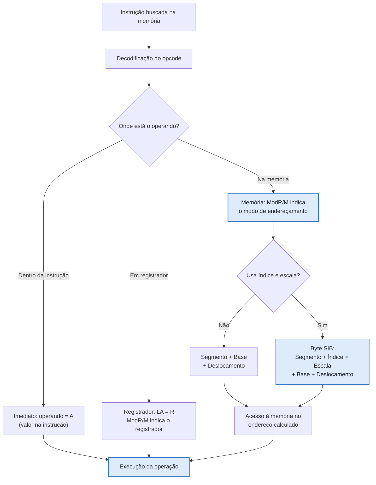
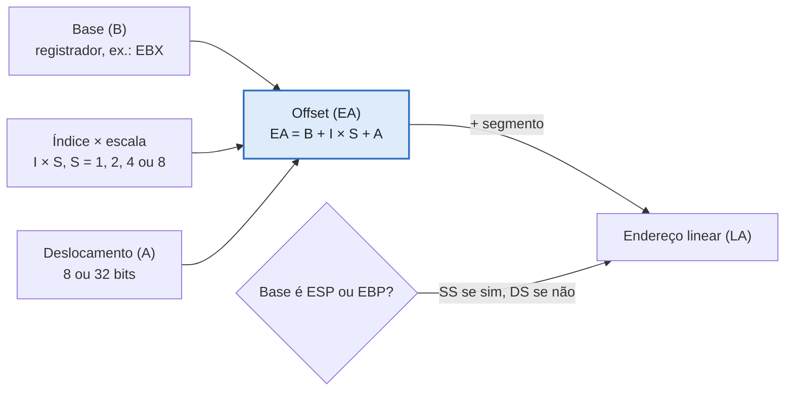
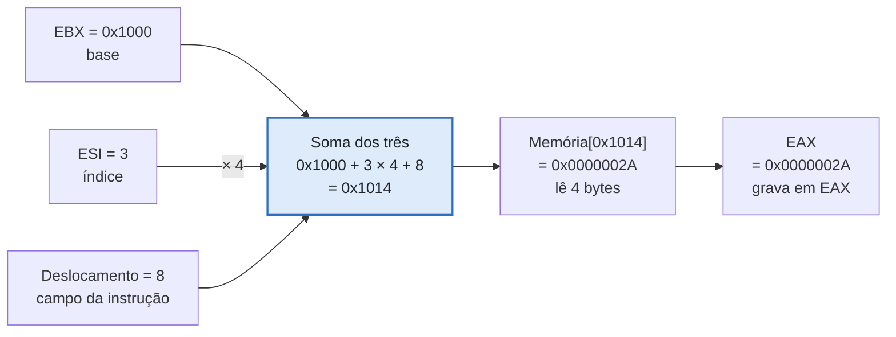
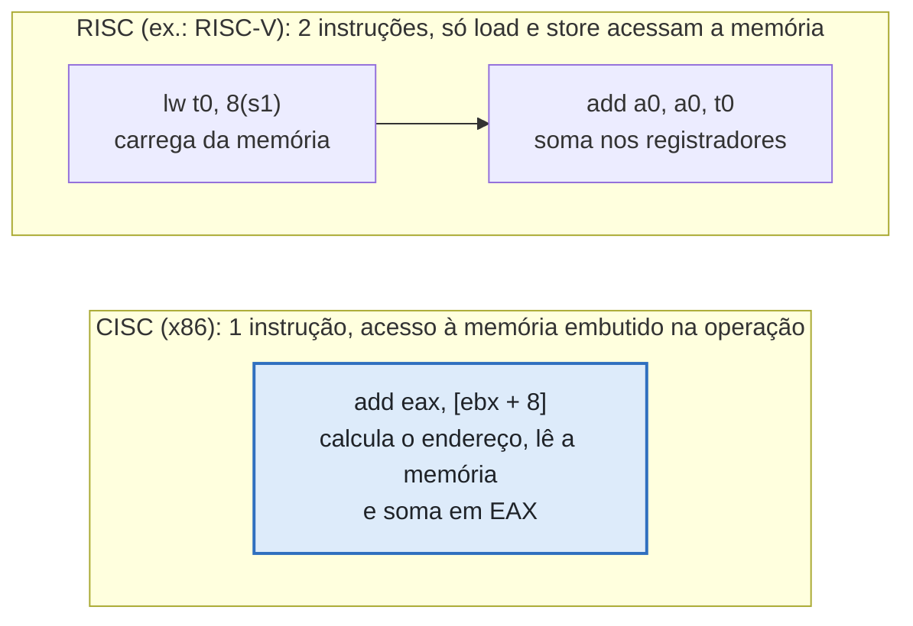

# Entrega 10 — Representação de Operações e Acesso aos Dados

| Campo | Descrição |
|---|---|
| **Objeto estudado** | Arquitetura CISC (*Complex Instruction Set Computer*), com a arquitetura x86 (IA-32, 32 bits) como caso principal |
| **Entrega** | 10 — Representação de Operações e Acesso aos Dados |
| **Referência-base** | STALLINGS, *Computer Organization and Architecture* (11ª ed.), cap. 14, "Instruction Sets: Addressing Modes and Formats" (na 10ª edição é o cap. 13; conferir na edição utilizada) |
---
> **Objetivo da atividade:** Investigar como uma operação em uma arquitetura CISC identifica, recebe ou localiza os dados necessários para sua execução. O x86 é usado como exemplo principal por ser a arquitetura CISC mais difundida. Como o x86 possui modos de endereçamento, a análise se concentra nos mais relevantes, sem classificar todos os mecanismos possíveis. O texto responde às dez perguntas da tarefa e traz a representação com diagramas e um exemplo concreto. As fontes estão no final.
---
## Resumo

Em uma instrução x86, cada operando pode estar em um de **três lugares**: **dentro da própria instrução** (valor imediato), **em um registrador** ou **na memória**, e a própria codificação da instrução indica qual deles. O **opcode** define a operação e a direção do dado; o byte **ModR/M** indica se o operando é registrador ou memória e qual modo de endereçamento é usado; o byte **SIB** (*Scale-Index-Base*) acrescenta índice e escala quando o modo exige; deslocamento e imediato ocupam os bytes finais. Quando o operando está na memória, o processador calcula o **endereço efetivo** (base + índice × escala + deslocamento) e o combina com o **registrador de segmento** (SS ou DS) para formar o **endereço linear**. Uma mesma instrução pode combinar acesso à memória e operação aritmética, sem exigir uma instrução de carga separada, como ocorre nas arquiteturas RISC do tipo load/store. O preço dessa flexibilidade é o **tamanho variável das instruções**, a decodificação mais complexa e as restrições de codificação (escala, deslocamento, registradores).

## 1. Como os operandos são fornecidos

Em uma instrução x86, cada operando pode estar em um de três lugares, e a própria instrução indica qual deles.

| Local do dado | Como a instrução o identifica | Exemplo |
|---|---|---|
| Dentro da própria instrução | Valor imediato codificado nos bytes da instrução | `mov eax, 10` |
| Em um registrador | Número do registrador codificado na instrução | `mov eax, ebx` |
| Na memória | Endereço calculado a partir de registradores e/ou deslocamento | `mov eax, [ebx + 8]` |

**Traço CISC:** uma mesma instrução pode combinar acesso à memória e operação aritmética, sem exigir uma instrução de carga separada, como ocorre nas arquiteturas RISC do tipo load/store.
---
## 2. Como os valores são identificados

Pela **codificação da instrução**:

- O **opcode** define a operação e a direção do dado.
- O byte **ModR/M** indica se o operando é registrador ou memória e qual modo de endereçamento é usado.
- O byte **SIB** (*Scale-Index-Base*) aparece quando o modo exige índice e escala.
- **Deslocamento** e **imediato** ocupam os bytes finais, quando necessários.

```text
[Prefixos opcionais] [Opcode] [ModR/M] [SIB, se necessário] [Deslocamento 8/32 bits] [Imediato, se houver]
```

Por isso as instruções x86 têm **tamanho variável**: quanto mais elaborado o modo de endereçamento, mais bytes a instrução ocupa.

**Figura 1 — Estrutura de uma instrução x86: dois bytes da instrução definem onde o operando está**



*Ordem dos bytes na memória (da esquerda para a direita). Em azul: bytes que selecionam o operando.* O ModR/M e o SIB, quando presente, descrevem o operando; os demais bytes trazem a operação e os valores.

**Figura 2 — Decodificação de ModR/M e SIB: o campo `mod` separa registrador de memória; `r/m = 100` chama o SIB**



- **Tamanho do deslocamento:** `mod = 00` nenhum · `mod = 01` 8 bits · `mod = 10` 32 bits.
- **Caso especial:** `mod = 00` e `r/m = 101` → endereço direto, só com deslocamento de 32 bits.

O campo `mod` separa registrador de memória; `r/m = 100` sinaliza que o byte SIB acompanha a instrução.
---
## 3. Como os dados armazenados são localizados

Pelo **cálculo do endereço efetivo**. No x86, o processador calcula um *offset* a partir de registradores e deslocamento e o combina com o registrador de segmento para formar o **endereço linear (LA)**.

**Fluxo de seleção do operando:**

1. A instrução é buscada na memória.
2. O opcode é decodificado.
3. Se o operando está na instrução, ele é um imediato (Operando = A).
4. Se está em registrador, o ModR/M indica qual (LA = R).
5. Se está na memória, o ModR/M indica o modo de endereçamento.
   - Sem índice e escala: `Segmento + Base + Deslocamento`.
   - Com índice e escala (byte SIB): `Segmento + Índice × Escala + Base + Deslocamento`.
6. O acesso à memória é feito no endereço calculado e a operação é executada.

**Figura 3 — Seleção do operando no x86: a instrução indica se o operando é imediato, registrador ou memória**



Imediato e registrador dispensam cálculo de endereço; só o acesso à memória passa pelo modo de endereçamento.
---
## 4. Existência de endereços e modos de endereçamento relevantes

**Sim**, existem endereços. Os modos básicos são os apresentados por Stallings (Tabela 14.1).

**Notação:** `A` = campo de endereço da instrução, `R` = registrador, `EA` = endereço efetivo, `(X)` = conteúdo de X.

### 4.1 Modos básicos (Stallings, Tabela 14.1)

| Modo | Algoritmo | Vantagem principal | Desvantagem principal |
|---|---|---|---|
| Imediato | `Operando = A` | Sem referência à memória | Magnitude do operando limitada |
| Direto | `EA = A` | Simples | Espaço de endereçamento limitado |
| Indireto | `EA = (A)` | Grande espaço de endereçamento | Várias referências à memória |
| Registrador | `EA = R` | Sem referência à memória | Espaço de endereçamento limitado |
| Registrador indireto | `EA = (R)` | Grande espaço de endereçamento | Uma referência extra à memória |
| Deslocamento | `EA = A + (R)` | Flexibilidade | Complexidade |
| Pilha | `EA = topo da pilha` | Sem referência à memória | Aplicabilidade limitada |

### 4.2 Modos do x86 (Stallings, Tabela 14.2)

**Notação:** `SR` = registrador de segmento, `B` = base, `I` = índice, `S` = escala, `A` = deslocamento/endereço, `LA` = endereço linear.

| Modo | Algoritmo | Exemplo |
|---|---|---|
| Imediato | `Operando = A` | `mov eax, 10` |
| Operando em registrador | `LA = R` | `mov eax, ebx` |
| Deslocamento | `LA = (SR) + A` | `mov eax, [0x1000]` |
| Base | `LA = (SR) + (B)` | `mov eax, [ebx]` |
| Base com deslocamento | `LA = (SR) + (B) + A` | `mov eax, [ebx + 8]` |
| Índice escalado com deslocamento | `LA = (SR) + (I) × S + A` | `mov eax, [esi*4 + 0x1000]` |
| Base com índice e deslocamento | `LA = (SR) + (B) + (I) + A` | `mov eax, [ebx + esi + 8]` |
| Base com índice escalado e deslocamento | `LA = (SR) + (I) × S + (B) + A` | `mov eax, [ebx + esi*4 + 8]` |
| Relativo | `LA = (PC) + A` | `jmp rótulo` (desvios) |

**Usos típicos:** base + deslocamento para acessar campos de estruturas e variáveis locais; índice escalado para percorrer vetores, em que a escala corresponde ao tamanho do elemento.
---
## 5. Como os registradores são utilizados

- **Registradores de uso geral** (`EAX`, `ECX`, `EDX`, `EBX`, `ESP`, `EBP`, `ESI`, `EDI`): guardam operandos, bases e índices.
- **Registradores de segmento** (`CS`, `DS`, `SS`, `ES`, `FS`, `GS`): o offset calculado é combinado com o segmento para formar o endereço linear. Quando a base é `ESP` ou `EBP`, o segmento padrão é `SS`; nos demais casos, `DS`.
- **Contador de programa** (`EIP`): usado no modo relativo, principalmente em desvios.

**Figura 4 — Cálculo do endereço efetivo e do segmento: o endereço linear soma o offset ao segmento escolhido**



*O processador lê ou grava o dado nesse endereço linear.* O offset soma base, índice × escala e deslocamento; o registrador de segmento (`SS` ou `DS`) completa o endereço linear.
---
## 6. Existência de posições, canais ou mecanismos equivalentes

**Sim.**

- **Pilha:** mecanismo implícito. `push` e `pop` usam `ESP` sem que o endereço apareça como operando.
- **Segmentação de memória:** o endereço lógico é formado por segmento e offset. É outro mecanismo de localização de dados no x86 clássico.
---
## 7. Como ocorre a seleção dos dados

A seleção é feita pela combinação de **opcode**, **ModR/M** e **SIB**, que descrevem qual operando usar e como calcular seu endereço quando ele está na memória. O processador decodifica esses bytes, calcula o endereço efetivo, acessa o dado e executa a operação.
---
## 8. Exemplo concreto

A instrução analisada é:

```nasm
mov eax, [ebx + esi*4 + 8]
```

**O que ela faz:** lê 4 bytes da memória, no endereço calculado a partir de `EBX` (base), `ESI` (índice), escala 4 e deslocamento 8, e grava o valor lido em `EAX`.

### 8.1 Valores hipotéticos para ilustrar

| Elemento | Valor |
|---|---|
| EBX (base) | `0x1000` |
| ESI (índice) | `3` |
| Escala | `4` |
| Deslocamento | `8` |

### 8.2 Cálculo do endereço efetivo (offset)

```text
EA = EBX + (ESI × 4) + 8
EA = 1000h + (3 × 4) + 8
EA = 1000h + 12 + 8
EA = 1014h
```

### 8.3 Visualização da operação

```text
EBX = 1000h            (registrador de base)
ESI × 4 = 12           (índice multiplicado pela escala)
Deslocamento = 8
Endereço efetivo = 1014h
Memória[1014h]         o processador lê 4 bytes nesse endereço
EAX recebe o valor lido
```

O offset é combinado com o registrador de segmento (`DS` neste caso, pois a base não é `ESP` nem `EBP`) para formar o endereço linear. Se a posição `0x1014` contiver `0x0000002A`, ao final `EAX = 0x0000002A` (42 em decimal).

**Figura 5 — Exemplo `mov eax, [ebx + esi*4 + 8]`: base, índice × 4 e deslocamento resultam em `0x1014`**



Com `EBX = 0x1000` e `ESI = 3`, o offset vale `0x1014`; se ali houver `0x0000002A`, `EAX` recebe esse valor.

### 8.4 Codificação em bytes

```text
8B 44 B3 08
```

| Byte | Significado |
|---|---|
| `8B` | Opcode de `MOV r32, r/m32` |
| `44` | ModR/M: `mod=01` (deslocamento de 8 bits), `reg=000` (EAX), `r/m=100` (há byte SIB) |
| `B3` | SIB: `scale=10` (×4), `index=110` (ESI), `base=011` (EBX) |
| `08` | Deslocamento de 8 bits |

**Em resumo:** uma única instrução realiza o cálculo do endereço e o acesso à memória, característica típica da filosofia CISC.
---
## 9. Como outros CISC resolvem o mesmo problema

O estudo de **Emer e Clark (1984)** sobre o **VAX-11/780** mostra que as instruções desse computador podem ter de **zero a seis especificadores de operando**, que descrevem os dados necessários à instrução. É a mesma ideia do x86 em outro CISC: o operando é descrito dentro da própria instrução, e a quantidade de modos e especificadores aumenta a complexidade de decodificação. O VAX é famoso por ter muitos modos de endereçamento. O **Motorola 68000** é outro CISC clássico para comparação.

**Figura 6 — Acesso à memória no CISC e no RISC: no CISC uma instrução acessa a memória e opera; no RISC são duas**



No x86 uma instrução embute o acesso à memória; no RISC, o load e a operação são instruções separadas.
---
## 10. Limitações desses mecanismos

- **`ESP` não pode ser usado como índice** no byte SIB.
- A **escala** é restrita aos valores 1, 2, 4 e 8.
- O **deslocamento** é limitado a 8 ou 32 bits.
- O x86 de 32 bits tem **poucos registradores de uso geral (8)**, o que favorece o uso da memória (as versões de 64 bits ampliaram para 16).
- **Instruções de tamanho variável** complicam a decodificação.
- **Mais modos de endereçamento exigem mais bits** para serem representados, argumento usado por Patterson e Ditzel (1980) na defesa do RISC.
---
## Fontes

### Livros e manuais

| # | Referência | Observação |
|---|---|---|
| 1 | STALLINGS, W. *Computer Organization and Architecture* (11ª ed.). [Link](https://os.ecci.ucr.ac.cr/ci0114/material/Stallings/Computer-Organization-Architecture-11th.pdf) | Base principal desta entrega (cap. 14; na 10ª edição, cap. 13) |
| 2 | TANENBAUM, A. S. *Structured Computer Organization*. [Link](https://dspace.sxcjpr.edu.in/jspui/bitstream/123456789/1057/1/Andrew%20S.%20Tanenbaum%20-%20Structured%20Computer%20Organization.pdf) | Apoio |
| 3 | PATTERSON, D. A.; HENNESSY, J. L. *Computer Organization and Design* (5ª ed.). [Link](https://www.youseficlass.ir/wp-content/uploads/2023/07/Computer_Organization_and_Design_5th_Edition_David_A_Patterson_John_watermark.pdf) | Apoio |
| 4 | Intel, manuais da arquitetura. [Link](https://manuals.plus/m/4d6d764b7dc5055ae5bc54d4e3349026e2aa7529935e485dd0a0bda0d79e22eb?utm_redirect=1) | Apoio |
| 5 | Intel, *Software Developer's Manuals*. [Link](https://www.intel.com/content/www/us/en/developer/articles/technical/intel-sdm.html) | Vol. 1: Basic Architecture, cap. 3 (endereçamento de operandos); Vol. 2: Instruction Set Reference, cap. 2 (formato de instrução com ModR/M e SIB) |
| 6 | AMD, documentação (*AMD64 Architecture Programmer's Manual*, Volume 1). [Link](https://docs.amd.com) | Apoio |
| 7 | CARTER, P. *PC Assembly Language*. [Link](https://pacman128.github.io/static/pcasmbook.pdf) | Apoio |
| 8 | HYDE, R. *The Art of Assembly Language* (2ª ed.). [Link](https://colorcomputerarchive.com/repo/Documents/Books/The%20Art%20of%20Assembly%20Language%202nd%20Edition%20%28Randall%20Hyde%29.pdf) | Apoio |
| 9 | *Memory segmentation* (Wikipedia). [Link](https://en.wikipedia.org/wiki/Memory_segmentation) | Segmentação de memória (seção 6) |
---
### Artigos acadêmicos

Estes dois trabalhos são particularmente relevantes para discutir a diferença entre as arquiteturas CISC e RISC.

| # | Referência | Observação |
|---|---|---|
| 1 | PATTERSON, D. A.; DITZEL, D. R. *The Case for the Reduced Instruction Set Computer*. ACM SIGARCH Computer Architecture News, v. 8, n. 6, p. 25–33, 1980. [DOI](https://doi.org/10.1145/641914.641917) · [Cópia](https://cs.utexas.edu/~fussell/courses/cs352h/papers/risc.pdf) | Discute os argumentos que fundamentaram a filosofia RISC e a simplificação dos conjuntos de instruções (seção 10) |
| 2 | EMER, J. S.; CLARK, D. W. *A Characterization of Processor Performance in the VAX-11/780*. 11th International Symposium on Computer Architecture (ISCA), p. 301–310, 1984. [DBLP](https://dblp1.uni-trier.de/rec/conf/isca/EmerC84.html) · [Cópia](https://people.csail.mit.edu/emer/media/papers/1984.05.isca.vax.pdf) | Útil para compreender o comportamento real de um processador VAX e a utilização de suas instruções (seção 9) |
---
### Referências gerais (apoio)

Servem para consulta rápida e compreensão inicial dos conceitos. **Não substituem os livros e documentos oficiais.**

**Outras CISC clássicas, para comparação:**

- VAX: <https://en.wikipedia.org/wiki/VAX>
- Motorola 68000: <https://en.wikipedia.org/wiki/Motorola_68000>

| Referência | Link |
|---|---|
| Addressing mode (inclui seções sobre x86 e outras CISC) | <https://en.wikipedia.org/wiki/Addressing_mode> |
| Complex instruction set computer (CISC) | <https://en.wikipedia.org/wiki/Complex_instruction_set_computer> |
| x86 assembly language | <https://en.wikipedia.org/wiki/X86_assembly_language> |
| ModR/M | <https://en.wikipedia.org/wiki/ModR/M> |
| Compiler Explorer (ver C virar assembly x86 e como os operandos aparecem) | <https://godbolt.org/> |
---
### Fontes complementares de assembly

- Site oficial de Randall Hyde e página editorial de *The Art of Assembly Language*.
- Oracle, *x86 Assembly Language Reference Manual*: operandos imediatos, registradores e memória.
- Referência técnica de codificação SIB: detalhes da seleção de registradores de base e índice.
