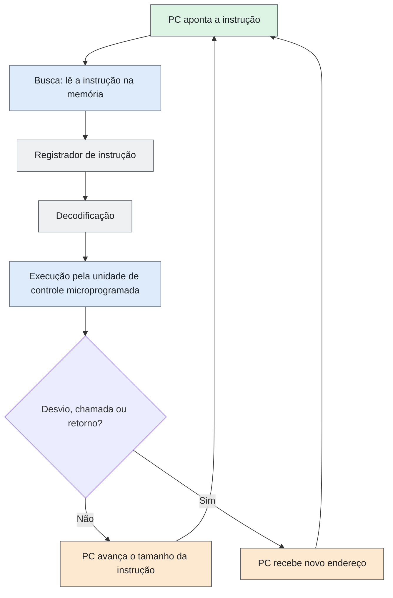

# Issues 07 — Fluxo de Controle e Execução

| Campo | Descrição |
|---|---|
| **Objeto estudado** | Arquitetura CISC (exemplo: Intel x86/x86-64) |
| **Issue** | 07 — Fluxo de Controle e Execução |
---
## Resumo

Em uma máquina CISC (x86 como exemplo), a execução segue o modelo de **fluxo de controle**: o programa fica armazenado na memória e o contador de programa indica a próxima instrução no fluxo arquitetural. No x86-64, esse registrador é chamado `RIP`. A CPU busca e decodifica instruções; muitas são convertidas diretamente em micro-operações, enquanto determinadas instruções podem utilizar microcódigo. O fluxo é sequencial do ponto de vista do programa, mas desvios, chamadas, interrupções e exceções podem redirecioná-lo. Um programa costuma terminar por uma chamada de sistema de saída ou por uma falha não tratada; `HLT` é uma instrução de parada da CPU, não uma forma comum de encerrar um programa de usuário.
---
## 1. Como uma operação é iniciada

Pelo **ciclo de busca**:

| Etapa | O que acontece |
|---|---|
| 1. Busca | A CPU busca a instrução indicada pelo contador de programa (PC; chamado `RIP` no x86-64). |
| 2. Registro | A instrução é colocada no registrador de instrução. |
| 3. Decodificação | A instrução é decodificada. |
---
## 2. Como a próxima operação é determinada

| Situação | O que acontece com o PC |
|---|---|
| Instrução comum | No fluxo sequencial, o próximo endereço corresponde à posição seguinte à instrução atual (no x86, após seu tamanho em bytes). |
| Desvio, chamada ou retorno | O contador de programa passa a indicar o endereço de destino. |
---
## 3. Mecanismos de controle

A unidade de controle coordena a execução. Nos processadores x86 modernos, muitas instruções são convertidas diretamente pelo decodificador em micro-operações; determinadas instruções mais complexas podem utilizar sequências de microcódigo.

**Traço CISC:** uma instrução pode envolver várias micro-operações, mas nem toda instrução exige microcódigo.
---
## 4. Sequência de execução

A execução é **sequencial do ponto de vista arquitetural do programa**, salvo quando uma instrução ou evento redireciona o fluxo. Internamente, processadores modernos podem sobrepor etapas e executar instruções fora de ordem, mantendo o comportamento arquitetural esperado. Uma única instrução também pode realizar várias ações, como ler um valor da memória, operar sobre ele e gravar o resultado.
---
## 5. Sincronização

O **clock** fornece a referência temporal para as operações síncronas do processador. Outros conceitos relacionados, mas diferentes, são:

- **Wait states:** ciclos de espera inseridos quando um recurso ou operação ainda não está pronto; não constituem, por si só, sincronização entre tarefas.
- **Interrupções:** eventos que redirecionam temporariamente o fluxo para um tratador.
- **`LOCK`:** prefixo usado com determinadas operações de memória para garantir atomicidade conforme as regras da arquitetura, importante em sistemas multiprocessados.
---
## 6. Mudanças no fluxo

O fluxo de execução muda por:

- desvios;
- `CALL` / `RET`;
- interrupções;
- exceções;
- chamadas de sistema.
---
## 7. Desvios, quando existentes

Os desvios **existem e são numerosos**.

| Tipo | Instruções | Comportamento |
|---|---|---|
| Incondicional | `JMP` | Vai sempre ao destino. |
| Condicional | `JE`, `JNE`, `JG`, `JL`… | Testam os flags (ZF, SF, CF, OF), alterados por instruções aritméticas ou de comparação (`CMP`, `TEST`). |
---
## 8. Repetições

As repetições permitem executar um conjunto de instruções várias vezes. No x86, um laço pode ser construído com um contador e um desvio condicional. Também existem instruções para operações repetidas sobre cadeias de dados, como `MOVS` e `CMPS`, que podem utilizar o prefixo `REP`.

**Exemplo em Assembly:**

```nasm
        mov   ecx, 5

repetir:
        ; corpo do laço
        dec   ecx
        jnz   repetir
```

Nesse exemplo, o corpo do laço é executado cinco vezes, desde que o corpo não altere o contador. `DEC` decrementa `ECX`, e `JNZ` retorna ao rótulo enquanto o resultado não for zero.
---
## 9. Participação humana no controle

- **Durante a execução:** não há, pois o fluxo é definido pelo programa.
- **Antes da execução:** o ser humano participa escrevendo ou compilando o código.
---
## 10. Condições que encerram uma operação ou tarefa

Um programa pode terminar normalmente ou de forma anormal. Exemplos:

| Condição | Descrição |
|---|---|
| Chamada de sistema de saída | Por exemplo, `exit`. |
| Exceção fatal | O programa é interrompido pela exceção. |
| `HLT` | Instrução privilegiada no x86 que interrompe a execução da CPU até um evento apropriado, como uma interrupção; não é uma forma normal de encerrar um programa de usuário. |
---
## 11. Representação: fluxo de execução

**Figura 1 — Ciclo de execução em uma máquina CISC**



> **Nota:** o diagrama é uma simplificação didática do fluxo arquitetural; processadores modernos podem sobrepor etapas e usar diferentes mecanismos internos de decodificação e execução.
---
### 11.1 Exemplo — desvio condicional no x86

```nasm
        cmp   eax, ebx
        je    igual
        ...
igual:
```

1. `CMP` compara EAX e EBX e altera os flags (ZF = 1 se os valores forem iguais).
2. `JE` testa o flag ZF.
3. Se ZF = 1, o PC recebe o endereço do rótulo `igual`. Caso contrário, o PC avança o tamanho da instrução e a execução segue em sequência.
---
## Fontes

| # | Referência | Usada em |
|---|---|---|
| 1 | Intel. *Intel 64 and IA-32 Architectures Software Developer’s Manual*. [Link](https://www.intel.com/content/www/us/en/developer/articles/technical/intel-sdm.html) | Seções 1, 2, 5, 6, 7, 9, 10 |
