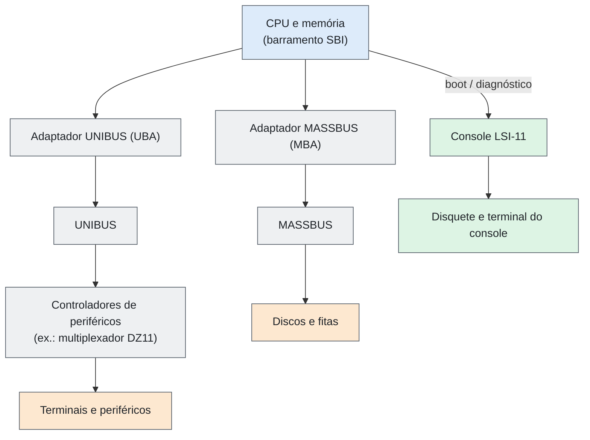
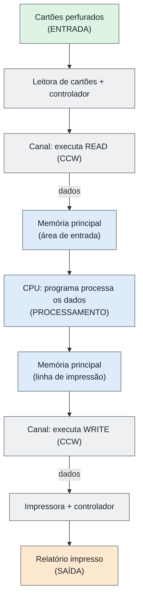
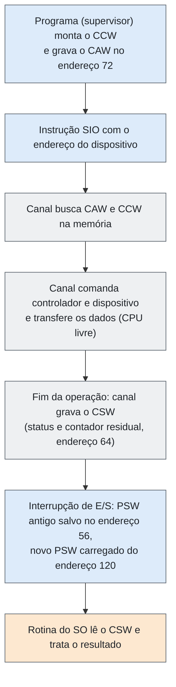
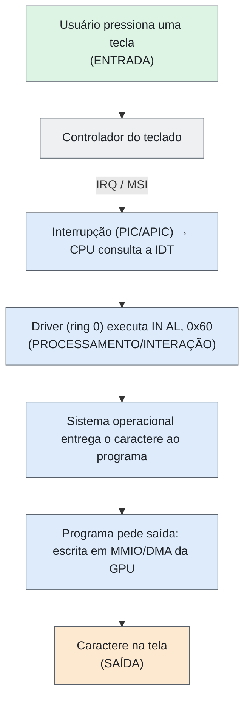

# Entrega 03 — Entrada, Saída e Interação com o Ambiente

| Campo | Descrição |
|---|---|
| **Objeto estudado** | Arquitetura CISC (exemplos: IBM System/360, DEC VAX-11/780, Intel x86/x86-64) |
| **Entrega** | 05 — Entrada, Saída e Interação com o Ambiente |
---
## Resumo

Nas máquinas CISC, a E/S evoluiu em três modelos. No **System/360**, a CPU **inicia** a operação com uma única instrução (`SIO`) e um **canal**, que é um processador de E/S, executa um programa de canal sozinho e avisa o fim por **interrupção**. No **VAX**, os registradores dos dispositivos aparecem no espaço de endereços e são acessados por instruções comuns, com adaptadores (UNIBUS/MASSBUS) movendo dados para a memória. No **x86**, coexistem **portas de E/S** (`IN`/`OUT`), **E/S mapeada em memória**, **DMA** e **interrupções** (APIC/MSI). O operador humano participa pelo console, pelo teclado e pelos meios de carga (cartões, floppy, firmware).
---
## 1. Como dados são fornecidos ao sistema

| Arquitetura | Como os dados entram |
|---|---|
| System/360 | Dispositivos (leitora de cartões, fita, disco, terminal) ligados a **controladores** e **canais**. O programa descreve a transferência em **CCWs** (palavras de comando de canal); o canal move os dados direto para uma área da memória. A CPU não copia byte a byte. |
| VAX-11/780 | Dispositivos nos barramentos **UNIBUS** e **MASSBUS**, ligados ao barramento interno do processador por adaptadores (UBA e MBA). Os registradores de controle dos dispositivos ficam no espaço de E/S e são lidos/escritos com instruções comuns; terminais entram por multiplexadores (ex.: DZ11). |
| x86 / x86-64 | Três caminhos: **portas de E/S** (`IN`/`OUT`), **registradores mapeados em memória** (MMIO, acessados com `MOV`) e **DMA**, em que o próprio dispositivo escreve na RAM. Teclado, rede, disco, USB e NVMe seguem esses mecanismos. |

**Traço CISC:** uma instrução faz muito. `SIO` dispara uma operação inteira de E/S, e as instruções de string do x86 (`REP INSB/INSW/INSD` e `REP OUTSB/OUTSW/OUTSD`) transferem blocos entre porta e memória com uma só instrução.

## 2. Como programas, instruções e configurações são inseridos

| Arquitetura | Mecanismo |
|---|---|
| System/360 | Programas e dados chegam em **baralhos de cartões**, fita ou disco. A carga inicial é o **IPL**: o operador escolhe nas chaves do painel o endereço do dispositivo de carga e aciona **LOAD**; o hardware lê o primeiro registro do dispositivo para o início da memória, executa os comandos de carga lidos e passa o controle ao programa. A descrição do trabalho vai em cartões de controle (JCL). |
| VAX-11/780 | O **console** é um microcomputador **LSI-11** com disquete (RX01) e terminal. O disquete carrega microcódigo na memória de controle e inicia o *bootstrap*; depois o sistema operacional é lido do disco. Ver [Hardware User’s Guide](https://mirrorservice.org/sites/www.bitsavers.org/pdf/dec/vax/780/EK-11780-UG-001_VAX-11_780_Hardware_Users_Guide_197902.pdf). |
| x86 / x86-64 | O **firmware** (BIOS/UEFI, em flash) inicializa o hardware e carrega o sistema de disco, USB ou rede. As opções de plataforma são editadas no *setup* do firmware. Atualizações de microcódigo são aplicadas na inicialização (ver [Intel SDM](https://www.intel.com/content/www/us/en/developer/articles/technical/intel-sdm.html)). Dispositivos PCI são configurados pelo **espaço de configuração PCI**. |
---
## 3. Como os resultados são obtidos

- **Resultado interno:** fica em registradores, flags e memória (ver Entrega 04). Só se torna visível ao ambiente por uma operação de saída.
- **System/360:** o programa emite um CCW de **escrita** (`WRITE`, código `X'01'`) para impressora, perfuradora de cartões, fita, disco ou console. Ao terminar, o canal grava o **CSW** (palavra de estado do canal, no endereço 64) e gera uma **interrupção de E/S**.
- **VAX:** o programa grava em registradores do controlador ou em buffers; o fim da operação é sinalizado por **interrupção** tratada pelo SO (vetor no *System Control Block*, com níveis de prioridade IPL de 0 a 31).
- **x86:** o driver grava em portas/MMIO ou prepara descritores para DMA; o dispositivo avisa o fim por **interrupção** (local APIC, I/O APIC ou MSI).
---
## 4. Dispositivos e mecanismos utilizados

| Arquitetura | Dispositivos típicos | Mecanismos |
|---|---|---|
| System/360 | Leitora e perfuradora de cartões, impressora de linha, fita magnética, disco, máquina de escrever do console | Canais (seletor e multiplexador), CCW, CAW, CSW, interrupção |
| VAX-11/780 | Discos e fitas (MASSBUS), terminais e periféricos (UNIBUS), console LSI-11, disquete | Adaptadores UBA/MBA, registradores no espaço de E/S, interrupções por vetor |
| x86-64 | Teclado, mouse, disco/SSD, placa de rede, vídeo, USB | Portas, MMIO, DMA, APIC/MSI, PCI/PCIe |
---
## 5. Participação humana

- **System/360:** o operador prepara os baralhos, monta fitas e discos, escolhe o dispositivo de IPL, aciona LOAD e usa o console para comandos e mensagens do sistema. O programador entrega cartões e recebe o relatório impresso.
- **VAX-11/780:** o operador usa o terminal do console (LSI-11) para ligar, carregar o *bootstrap* e comandar o sistema.
- **x86:** o usuário interage por teclado, mouse e tela. O administrador usa o *setup* do firmware. O restante (DMA, interrupções, atualização de microcódigo) é automático.
---
## 6. Interfaces externas

No VAX-11/780, as interfaces externas são barramentos com adaptadores dedicados, mais o console independente. A figura resume a organização. Em configurações-padrão da época, havia um adaptador UNIBUS integral ao processador, e o relatório [Datapro](https://ftp.mirrorservice.org/sites/www.bitsavers.org/pdf/datapro/datapro_reports_70s-90s/DEC/M11-384-40_7805_DEC_VAX-11_780.pdf) indica taxa máxima agregada de **1,5 MB/s** pelo UNIBUS.
---
**Figura 1 — Interfaces de E/S do VAX-11/780 (simplificado)**


---
## 7. Mecanismos automáticos e manuais

| Arquitetura | Manual | Automático |
|---|---|---|
| System/360 | Chaves e botão LOAD do painel, troca de cartões/fitas, comandos no console | Programa de canal (CCW), transferência de dados, interrupção de fim de operação |
| VAX-11/780 | Comandos no console LSI-11, troca de disquete | Adaptadores UBA/MBA, interrupções vetoradas, *bootstrap* |
| x86-64 | Setup do firmware, escolha de dispositivo de boot | DMA, interrupções, enumeração de dispositivos PCI, microcódigo |
---
## 8. Limitações do processo de entrada e saída

- **Instruções de E/S são privilegiadas.** No System/360, `SIO`, `TIO`, `HIO` e `TCH` só rodam em estado supervisor; programas de aplicação pedem E/S ao sistema operacional (`SVC`). No x86, `IN`/`OUT` exigem privilégio suficiente (nível de privilégio ≤ IOPL ou permissão no *I/O permission bitmap* do TSS).
- **Velocidade dos periféricos.** Cartões, fitas e discos são muito mais lentos que a CPU. Os canais e as interrupções existem para a CPU não ficar esperando.
- **Capacidade dos barramentos.** O UNIBUS do VAX-11/780 limita-se a cerca de 1,5 MB/s agregados, segundo o [Datapro](https://ftp.mirrorservice.org/sites/www.bitsavers.org/pdf/datapro/datapro_reports_70s-90s/DEC/M11-384-40_7805_DEC_VAX-11_780.pdf).
- **Canais.** Um canal seletor atende uma operação de cada vez; periféricos lentos usam o multiplexador, que intercala vários.
- **Espaço de portas do x86.** São 65.536 portas (64 KiB). Portas são endereçadas à parte da memória, e MMIO exige memória **não cacheável** para o dispositivo ver cada acesso.
- **Latência de interrupção e de acesso.** Cada acesso a dispositivo é mais lento que a RAM, e o tratamento de interrupção tem custo (salvar estado, trocar de contexto).
- **Segurança do DMA.** Um dispositivo com DMA pode escrever em qualquer endereço, a menos que haja mecanismo de proteção (IOMMU).
---
## 9. Representação: fluxo entrada → processamento/interação → saída

### 9.1 Exemplo 1 — System/360: ler cartões, processar e imprimir

**Figura 2 — Fluxo completo no System/360 (cartão → relatório)**



O trecho abaixo mostra o início de uma leitura de cartão. O dispositivo `00C` (canal 0, unidade 0C) é um exemplo de endereço.

```asm
         LA    1,CCW1            R1 = endereço do programa de canal
         ST    1,72              CAW (endereço 72) aponta para o 1º CCW
         SIO   X'00C'            inicia a E/S; o canal passa a trabalhar
         BC    8,INICIOK         CC=0: operação iniciada
*        CC=1: CSW gravado | CC=2: ocupado | CC=3: não operacional
CCW1     CCW   X'02',AREA,X'00',80   READ (02): 80 bytes = 1 cartão
AREA     DS    CL80              área de entrada na memória
```

Campos de um CCW: **código do comando** (ex.: `02` leitura, `01` escrita, `04` sense), **endereço dos dados**, **flags** (encadeamento de dados/comandos) e **contador** de bytes. Depois do `SIO`, a CPU segue executando outras instruções enquanto o canal trabalha:

**Figura 3 — Ciclo de uma operação de E/S no System/360**



### 9.2 Exemplo 2 — x86: tecla pressionada até o software tratar

Exemplo didático do PC clássico (teclado PS/2). Em sistemas atuais, a tecla chega por USB, mas o padrão é o mesmo: dispositivo → interrupção → driver lê o dado → software processa → saída.

**Figura 4 — Fluxo de E/S no x86 (conceitual)**



```nasm
; leitura de um byte da porta do teclado (modo privilegiado)
        mov   dx, 0x60
        in    al, dx            ; AL = scancode da tecla
; avisa ao PIC 8259 que a interrupção foi tratada (EOI)
        mov   al, 0x20
        out   0x20, al
; instrução de string: lê 256 words da porta 0x1F0 para a memória
        cld
        mov   dx, 0x1F0
        mov   rdi, buffer
        mov   ecx, 256
        rep insw                ; uma instrução, 256 transferências
```
---
### 9.3 Exemplo 3 — VAX-11/780: inicialização pelo console

Fluxo de entrada de programa e configuração: operador → console LSI-11 → disquete (microcódigo e *bootstrap*) → memória de controle e memória principal → sistema operacional lido do disco pelo MASSBUS → sistema pronto, com terminais e periféricos ativos. Os componentes aparecem na figura da seção 6.
---
## Fontes

| # | Referência | Usada em |
|---|---|---|
| 1 | IBM. *System/360 Principles of Operation* (A22-6821). [Link](https://ftp.mirrorservice.org/sites/www.bitsavers.org/pdf/ibm/360/princOps/A22-6821-6_360PrincOpsJan67.pdf) | Seções 1, 2, 3, 8, 9.1 |
| 2 | DEC. *VAX-11/780 Hardware User’s Guide* (EK-11780-UG-001, 1979). [Link](https://mirrorservice.org/sites/www.bitsavers.org/pdf/dec/vax/780/EK-11780-UG-001_VAX-11_780_Hardware_Users_Guide_197902.pdf) | Seções 2, 5, 6, 9.3 |
| 3 | DEC. *VAX Architecture Handbook* (1981). [Link](https://50anni.informatica.unisa.it/wp-content/uploads/2023/02/02-VAX-architecture-handbook-1981.pdf) | Seções 1, 3 |
| 4 | Datapro. *DEC VAX-11/780* (1978). [Link](https://ftp.mirrorservice.org/sites/www.bitsavers.org/pdf/datapro/datapro_reports_70s-90s/DEC/M11-384-40_7805_DEC_VAX-11_780.pdf) | Seções 6, 8 |
| 5 | Intel. *Intel 64 and IA-32 Architectures Software Developer’s Manual*. [Link](https://www.intel.com/content/www/us/en/developer/articles/technical/intel-sdm.html) | Seções 1, 2, 3, 8, 9.2 |

> **Nota:** localizei os documentos pelos links acima, mas não conferi página por página. Antes da versão final, confirme nos manuais os detalhes do IPL, dos endereços fixos (CAW 72, CSW 64, PSWs de E/S em 56 e 120) e dos níveis de IPL do VAX. O código do 9.1 e do 9.2 é ilustrativo.
