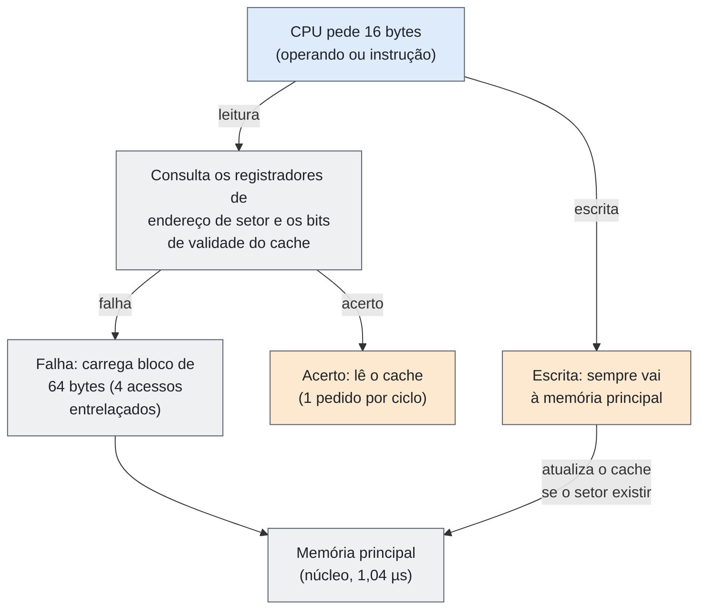

# Entrega 05 — Acesso aos Dados e Fluxo de Informação

| Campo | Descrição |
|---|---|
| **Objeto estudado** | Arquitetura CISC (exemplos: IBM System/360 Model 85, DEC VAX-11/780, Intel x86/x86-64) |
| **Entrega** | 05 — Acesso aos Dados e Fluxo de Informação |
| **Issues relacionadas** | `#__` (preencher: issues anteriores sobre CISC, armazenamento e E/S) |
| **Status** | Pronto para revisão |

> **Escopo:** o conceito de CISC não é repetido (já tratado em issues anteriores). O texto responde aos oito itens da tarefa e traz a representação do caminho dos dados com diagramas e exemplos. As fontes estão no final.

## Resumo

Em máquinas CISC, os dados chegam às unidades de processamento por **operandos de diferentes origens**: registradores, constantes dentro da instrução e **memória**, que pode ser lida ou escrita diretamente pela instrução. Por isso o caminho **memória → processamento → memória** é parte normal da execução, e a organização do acesso à memória (cache, buffers, tradução de endereços, entrelaçamento) define o desempenho. As três máquinas estudadas mostram três etapas dessa evolução: o **System/360 Model 85** introduziu o **cache** como nível transparente ao programa; o **VAX-11/780** combinou **buffer de instruções, TB, cache e buffer de escrita** com execução microcodificada; e o **x86 atual** acrescenta **vários níveis de cache, execução fora de ordem e tradução em micro-operações**.

## 1. De onde vêm os dados

| Origem | Descrição |
|---|---|
| Dentro da instrução | Constantes (imediatos) e deslocamentos. No VAX, constantes curtas (*short literal*) ocupam um único byte. |
| Registradores | Operandos já carregados na CPU. No VAX-11/780, cerca de 41% dos especificadores de operando são registradores. |
| Memória principal | Variáveis, vetores, pilha e tabelas do sistema. Instruções CISC podem usá-la diretamente como operando. |
| Tabelas de tradução de endereços | Tabelas de páginas lidas pelo hardware ou pelo microcódigo (VAX e x86) para converter endereços virtuais em físicos. |
| Armazenamento externo e E/S | Disco, fita, rede. Chegam à memória por canais (System/360) ou por DMA (VAX e x86) antes de serem processados. |

## 2. Como os dados chegam às unidades de processamento

| Arquitetura | Caminho até a unidade de execução |
|---|---|
| System/360 | O endereço do operando é calculado como **base + índice + deslocamento** (formato RX) com 24 bits. Os dados vêm da memória principal para os registradores. No **Model 85**, o acesso passa antes pelo cache; a CPU lê palavras de **16 bytes**. |
| VAX-11/780 | Pipeline de três estágios: **I-Fetch** (busca instruções para um buffer de 8 bytes), **I-Decode** (decodifica opcode e especificadores) e **EBOX** (unidade microcodificada que busca operandos e executa). Todo acesso à memória passa pela **TB** (tradução) e pelo **cache** antes de ir à memória pelo barramento SBI. |
| x86 / x86-64 | A instrução é decodificada em **micro-operações**. Uma unidade de geração de endereço calcula `base + índice×escala + deslocamento`, o **TLB** traduz o endereço e o dado vem do **cache L1**, de L2/L3 ou da DRAM. |

**Traço CISC:** o cálculo de endereço faz parte da própria instrução (modos de endereçamento ricos). Uma única instrução pode gerar vários acessos à memória, como mostram os exemplos da seção 9.

## 3. Onde resultados intermediários são mantidos

| Local | Uso |
|---|---|
| Registradores gerais e de ponto flutuante | Principal local de resultados: 16 registradores no System/360, no VAX e no x86-64. |
| Flags / palavra de estado (PSW, PSL, RFLAGS) | Resultado de comparações e operações (zero, sinal, carry, overflow), usado pelos desvios seguintes. |
| Registradores internos do microcódigo | Valores temporários dentro da execução de uma instrução complexa (EBOX do VAX; micro-operações do x86). |
| Pilha na memória | Parâmetros, endereços de retorno e variáveis locais (VAX e x86; o System/360 usa áreas de salvamento e registrador de ligação). |
| Buffers de escrita | Guardam a escrita pendente enquanto a execução continua: 4 bytes no VAX-11/780, uma instrução de escrita pendente no Model 85 e *store buffer* no x86. |
| Registradores físicos (x86) | Arquivo de registradores maior que o visível ao programa, usado para renomeação e execução fora de ordem. |

## 4. Como ocorre a movimentação das informações

| Arquitetura | Unidade de transferência | Política de escrita |
|---|---|---|
| System/360 Model 85 | Memória → cache em **blocos de 64 bytes**, carregados sob demanda dentro de **setores de 1 KiB**; CPU ↔ memória em palavras de 16 bytes | **Write-through:** toda escrita vai à memória principal; o cache só é atualizado se o setor já estiver presente |
| VAX-11/780 | Caminho de 32 bits até o cache; memória por barramento SBI | **Write-through** com buffer de escrita de 4 bytes; escrita que erra o cache não o atualiza |
| x86 / x86-64 | **Linhas de cache** (64 bytes na maioria dos processadores atuais) | Em geral **write-back** (tipo de memória WB), com outros tipos disponíveis (WT, WC, UC) |

- **Leitura:** a CPU consulta primeiro o nível mais próximo. Em caso de falha, o bloco ou a linha é buscado no nível seguinte e instalado no cache.
- **Escrita:** vai ao buffer de escrita e, conforme a política, ao cache e/ou à memória.
- **E/S:** no Model 85, o canal lê direto da memória principal (sem usar o cache) e suas escritas são tratadas como as da CPU, atualizando o cache se o dado estiver presente. Isso mantém o conteúdo coerente. No x86, o DMA dos dispositivos normalmente é coerente com os caches.

## 5. Ordem ou prioridade dos acessos

| Arquitetura | Regras de ordem e prioridade |
|---|---|
| System/360 Model 85 | Em falha de leitura, o módulo de memória que contém os **16 bytes pedidos é acessado primeiro** e o dado segue direto à CPU, sem esperar o bloco inteiro. Escritas não provocam carga de bloco nem trocam setor do cache. |
| VAX-11/780 | A decodificação da instrução seguinte só começa **depois que a anterior termina**. Em falha de leitura de dados, a EBOX **para** (*read stall*; no caso mais simples, 6 ciclos). Em falha na busca de instrução, a EBOX continua até precisar dos bytes. Só a EBOX escreve dados. Uma segunda escrita antes de a anterior terminar causa *write stall*. |
| x86 / x86-64 | O processador executa fora de ordem, mas os efeitos visíveis seguem o **modelo de ordenação de memória**: leituras não passam outras leituras, escritas não passam outras escritas, e uma leitura pode passar uma escrita anterior a outro endereço (por causa do *store buffer*). Instruções `LOCK`, `XCHG` e *fences* (`MFENCE`, `LFENCE`, `SFENCE`) impõem ordem adicional. |

## 6. Existência de níveis de armazenamento

| Arquitetura | Níveis (do mais rápido ao mais lento) |
|---|---|
| System/360 (modelos comuns) | Registradores → memória principal (núcleo magnético) → armazenamento externo (disco, fita) |
| System/360 Model 85 | Registradores → **cache de 16 KiB** (opcional 24 ou 32 KiB, ciclo de 80 ns) → memória principal de 512 KiB a 4 MiB (ciclo de 1,04 µs) → armazenamento externo |
| VAX-11/780 | Registradores → buffer de instruções (8 bytes) → **TB e cache** → memória principal (via SBI) → disco e fita (MASSBUS/UNIBUS) |
| x86-64 | Registradores → **L1 (instruções e dados)** → **L2** → **L3** → DRAM → SSD/HDD. Ao lado: TLBs, cache de micro-ops e *store buffer*. |

O Model 85 foi a primeira máquina da linha System/360 a ter cache. O cache não é endereçável pelo programa: o hardware decide sozinho o que manter, e o programa vê só a memória principal.

## 7. Mecanismos utilizados para acelerar acessos

| Mecanismo | Onde aparece | Efeito |
|---|---|---|
| Cache | Model 85, VAX-11/780, x86 | No Model 85, a probabilidade média de achar o dado no cache foi de **0,968**, com desempenho médio de **81%** do ideal (memória inteira na velocidade do cache) |
| Entrelaçamento de memória | Model 85 | Memória em 4 vias: um bloco de 64 bytes é carregado com 4 acessos de 16 bytes, um a cada módulo |
| Dado crítico primeiro | Model 85 | O módulo com os 16 bytes pedidos é lido primeiro e o dado vai à CPU em paralelo à carga do cache |
| Buffer de instruções e pré-busca | VAX (8 bytes), x86 (fila de pré-busca) | A busca de instruções corre à frente da execução |
| TLB / TB | VAX e x86 | No VAX-11/780: 0,029 faltas por instrução, cerca de 21,6 ciclos por falta |
| Buffer de escrita | VAX, Model 85, x86 | A execução continua sem esperar a escrita terminar |
| Microcódigo ajustado ao acesso | VAX | Instruções de cadeia de caracteres escrevem a cada seis ciclos, para evitar *write stalls* |
| Operandos em registradores e literais curtos | VAX | Evitam acessos à memória (41% dos especificadores são registradores) |
| Execução fora de ordem, renomeação, predição de desvios, cache de micro-ops | x86 | Escondem a latência de memória e mantêm a unidade de execução ocupada |
| Pré-busca de dados e escrita não temporal | x86 (`PREFETCH`, `MOVNT*`) | Trazem dados antes do uso ou evitam poluir o cache |

## 8. Limitações ou gargalos

- **Velocidade da memória principal:** no Model 85, a memória (1,04 µs) era cerca de 13 vezes mais lenta que o ciclo do processador (80 ns), motivo da adoção do cache. A diferença entre CPU e DRAM continua e é o gargalo central no x86 atual.
- **Esperas por memória no VAX-11/780:** em média, uma instrução levou **10,6 ciclos**, dos quais cerca de **2,1** foram esperas (0,96 de leitura, 0,45 de escrita e 0,72 por falta de bytes no buffer de instruções), ou seja, cerca de 20% do tempo.
- **Escritas em sequência:** no VAX-11/780, `CALL`/`RET` geram muitos *write stalls*, porque o cache é write-through e o buffer de escrita guarda uma só escrita.
- **Tradução de endereços:** as leituras de entradas da tabela de páginas falham no cache com frequência. No VAX-11/780, as leituras paradas da gerência de memória foram mais de 3 vezes as leituras feitas. No x86, uma falta no TLB exige percorrer a tabela de páginas (vários acessos à memória).
- **Instruções de tamanho variável:** média de 3,8 bytes por instrução no VAX. Faltas ao buscar o alvo de um desvio deixam o decodificador sem bytes.
- **Desalinhamento:** operandos que cruzam a fronteira do cache exigem dois acessos físicos (0,016 por instrução no VAX).
- **Várias instruções, vários acessos:** operandos em memória e modos de endereçamento complexos geram mais de um acesso por instrução e dificultam o pipeline.
- **Coerência entre núcleos (x86):** dados compartilhados entre núcleos exigem protocolos de coerência, que acrescentam latência.

## 9. Representação: caminho percorrido pelos dados

A figura 1 resume o caminho geral. As figuras seguintes mostram o caminho real em cada máquina, seguidas de exemplos de instrução.

**Figura 1 — Caminho geral dos dados em uma máquina CISC**

```mermaid
flowchart TB
  DSK["Armazenamento externo<br/>(disco, fita, SSD)"]:::dev
  RAM["Memória principal<br/>(programas, dados, pilha)"]:::proc
  CAC["Cache e TLB / TB<br/>(quando existem)"]:::dev
  REG["Registradores"]:::proc
  EXE["Unidade de execução<br/>(microcódigo ou micro-operações)"]:::proc
  RES["Resultado em registrador / flags"]:::out
  WB["Buffer de escrita"]:::dev
  DSK -->|canal / DMA| RAM
  RAM -->|linha ou bloco| CAC
  CAC -->|leitura| REG
  REG -->|operandos| EXE
  EXE --> RES
  RES -->|escrita (se o destino é memória)| WB
  WB -->|write-through ou write-back| RAM
  classDef in fill:#DDF4E4,stroke:#57606A,color:#1F2328
  classDef proc fill:#DDEBFA,stroke:#57606A,color:#1F2328
  classDef out fill:#FDE8D0,stroke:#57606A,color:#1F2328
  classDef dev fill:#EEF0F2,stroke:#57606A,color:#1F2328
```

### 9.1 Exemplo 1 — System/360 Model 85: leitura de um operando

**Figura 2 — Acesso de leitura e escrita no cache do Model 85**



```asm
         A     3,12(4,5)        R3 = R3 + palavra em (R5 + R4 + 12)
```

1. Endereço efetivo = conteúdo de R5 (base) + conteúdo de R4 (índice) + 12 (deslocamento).
2. O hardware consulta o cache. Em caso de acerto, o dado chega em 2 ciclos; em caso de falha, o bloco de 64 bytes é trazido da memória principal e o dado segue direto à CPU.
3. A palavra de 32 bits é somada a R3 (a instrução tem 1 acesso de leitura e nenhum de escrita na memória).
4. O código de condição é atualizado com o resultado.

### 9.2 Exemplo 2 — VAX-11/780: instrução com dois operandos em memória

**Figura 3 — Caminho dos dados no VAX-11/780**

```mermaid
flowchart TB
  IF["I-Fetch<br/>busca os bytes das instruções"]:::proc
  IB["Buffer de instruções<br/>(8 bytes)"]:::dev
  ID["I-Decode<br/>opcode e especificadores"]:::proc
  EB["EBOX<br/>(microcódigo: operandos e execução)"]:::proc
  TB["TB: tradução<br/>virtual → físico"]:::dev
  CA["Cache"]:::dev
  WBF["Buffer de escrita<br/>(4 bytes)"]:::dev
  SBI["Barramento SBI"]:::dev
  MEM["Memória principal"]:::dev
  IF --> IB
  IB --> ID
  ID --> EB
  IF -->|end. virtual| TB
  EB -->|end. virtual| TB
  TB -->|end. físico| CA
  CA -->|dado (acerto: 1 ciclo)| EB
  CA -->|falha: pelo menos 6 ciclos| SBI
  SBI --> MEM
  EB -->|escrita| WBF
  WBF -->|write-through| SBI
  classDef in fill:#DDF4E4,stroke:#57606A,color:#1F2328
  classDef proc fill:#DDEBFA,stroke:#57606A,color:#1F2328
  classDef out fill:#FDE8D0,stroke:#57606A,color:#1F2328
  classDef dev fill:#EEF0F2,stroke:#57606A,color:#1F2328
```

```asm
        ADDL3  (R1)+, 8(R2), R3    R3 = mem[R1] + mem[R2 + 8]; R1 = R1 + 4
```

1. **I-Fetch** traz os bytes da instrução para o buffer; **I-Decode** separa o opcode e os três especificadores.
2. **Especificador 1** (autoincremento): a EBOX lê a longword apontada por R1 (passando por TB e cache) e depois soma 4 a R1.
3. **Especificador 2** (deslocamento): a EBOX soma R2 + 8, traduz o endereço e lê a segunda longword.
4. **Execução:** a ULA soma os dois valores.
5. **Especificador 3** (registrador): o resultado é gravado em R3, sem escrita na memória.
6. Total desta instrução: **2 leituras e nenhuma escrita** de dados na memória, além da busca da própria instrução (em média, 3,8 bytes por instrução).

### 9.3 Exemplo 3 — x86-64: soma com operando de leitura e escrita na memória

**Figura 4 — Caminho de uma instrução com operando em memória no x86**

```mermaid
flowchart TB
  I["ADD [RBX+RCX*4+8], EAX<br/>(instrução CISC)"]:::in
  DEC["Decodificador: traduz em micro-operações"]:::proc
  AGU["Micro-op 1: calcula o endereço<br/>RBX + RCX×4 + 8"]:::proc
  TLB["TLB: endereço virtual → físico"]:::dev
  L1["Cache L1 de dados"]:::dev
  L2["L2 / L3 / DRAM"]:::dev
  ALU["Micro-op 2: ALU soma com EAX<br/>flags atualizadas"]:::proc
  SB["Micro-op 3: store buffer<br/>(escrita pendente)"]:::out
  I --> DEC
  DEC --> AGU
  AGU --> TLB
  TLB -->|end. físico| L1
  L1 -->|falha| L2
  L2 -->|linha de 64 bytes| L1
  L1 -->|dado lido| ALU
  ALU -->|resultado| SB
  SB -->|grava na linha (write-back)| L1
  classDef in fill:#DDF4E4,stroke:#57606A,color:#1F2328
  classDef proc fill:#DDEBFA,stroke:#57606A,color:#1F2328
  classDef out fill:#FDE8D0,stroke:#57606A,color:#1F2328
  classDef dev fill:#EEF0F2,stroke:#57606A,color:#1F2328
```

```nasm
        add   dword [rbx + rcx*4 + 8], eax   ; mem = mem + EAX (lê e escreve)
```

1. O decodificador separa a instrução em leitura, soma e escrita.
2. O endereço efetivo é calculado e traduzido pelo TLB. Se faltar, a tabela de páginas é percorrida.
3. O dado vem do L1. Em caso de falha, a linha de 64 bytes sobe de L2, L3 ou DRAM.
4. A ALU soma o valor lido com EAX e atualiza as flags.
5. A escrita fica no *store buffer* e chega ao L1 depois; leituras seguintes ao mesmo endereço recebem o valor do buffer. Total: **1 leitura e 1 escrita** no mesmo endereço.

## Checklist da entrega

- [x] De onde vêm os dados (seção 1)
- [x] Como chegam às unidades de processamento (seção 2)
- [x] Onde resultados intermediários são mantidos (seção 3)
- [x] Como ocorre a movimentação das informações (seção 4)
- [x] Ordem ou prioridade dos acessos (seção 5)
- [x] Existência de níveis de armazenamento (seção 6)
- [x] Mecanismos para acelerar acessos (seção 7)
- [x] Limitações ou gargalos (seção 8)
- [x] Representação do caminho dos dados, com diagramas e exemplos (seção 9)
- [x] Fontes com link (abaixo)

## Fontes

| # | Referência | Usada em |
|---|---|---|
| 1 | LIPTAY, J. S. *Structural aspects of the System/360 Model 85, II: The cache*. IBM Systems Journal, v. 7, n. 1, 1968. [Link](https://www.andrew.cmu.edu/course/15-440-sp15/assets/READINGS/liptay1968.pdf) | Seções 2, 4, 5, 6, 7, 8, 9.1 |
| 2 | EMER, J. S.; CLARK, D. W. *A Characterization of Processor Performance in the VAX-11/780*. ISCA, 1984. [Link](https://people.csail.mit.edu/emer/media/papers/1984.05.isca.vax.pdf) | Seções 1, 2, 3, 4, 5, 6, 7, 8, 9.2 |
| 3 | IBM. *System/360 Principles of Operation* (A22-6821). [Link](https://ftp.mirrorservice.org/sites/www.bitsavers.org/pdf/ibm/360/princOps/A22-6821-6_360PrincOpsJan67.pdf) | Seções 2, 3, 9.1 |
| 4 | Intel. *Intel 64 and IA-32 Architectures Software Developer’s Manual*. [Link](https://www.intel.com/content/www/us/en/developer/articles/technical/intel-sdm.html) | Seções 2, 3, 4, 5, 7, 9.3 |
| 5 | DREPPER, U. *What Every Programmer Should Know About Memory*. 2007. [Link](http://www.akkadia.org/drepper/cpumemory.pdf) | Seções 4, 6, 7, 8, 9.3 |

> **Nota:** os números do System/360 Model 85 vêm do artigo de Liptay (simulações de 1968). Os do VAX-11/780 são médias medidas em carga de *time-sharing* sob VMS. Os valores do x86 (linha de 64 bytes, políticas de cache, ordenação de memória) são típicos e variam por modelo. Conferir página e edição exata antes da versão final.
