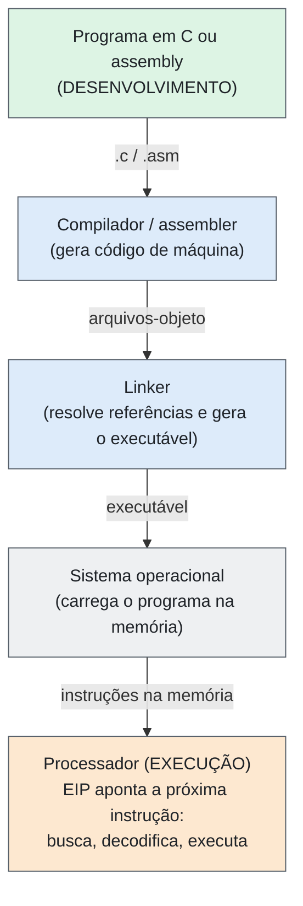
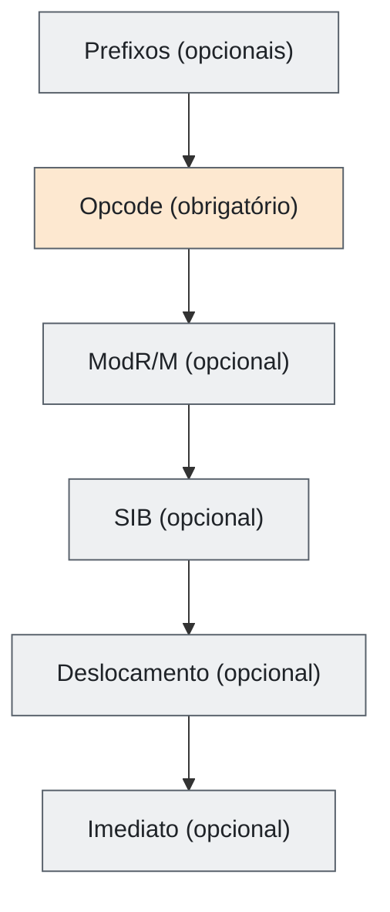
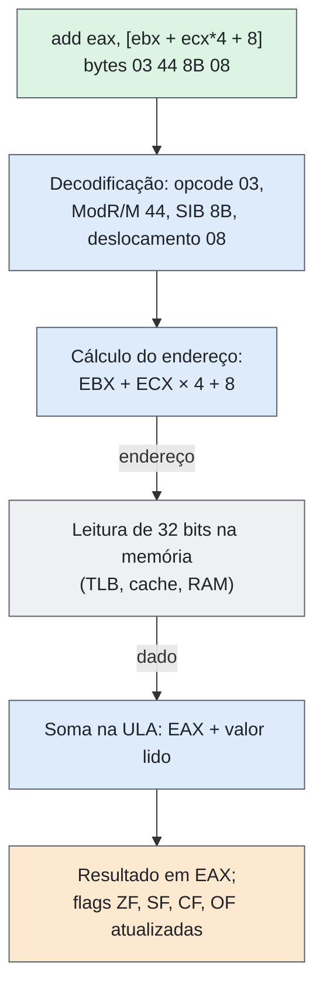

# Entrega 09 — Modelo de Operação e Instruções

| Campo | Descrição |
|---|---|
| **Objeto estudado** | Arquitetura CISC, com o x86 de 32 bits (IA-32) como caso principal |
| **Entrega** | 09 — Modelo de Operação e Instruções |
| **Disciplina** | Computer Organization and Architecture |
| **Issue** | #27 (o PR deve conter `Related to #27`) |
| **Data de entrega** | 05/11/2026 |
| **Status** | Pronto para revisão |

> **Escopo:** o conceito de CISC não é repetido (já tratado em issues anteriores). O IA-32 é o exemplo principal, e o x86-64 aparece só quando ajuda a comparar. Há comparações com RISC quando elas esclarecem o assunto. As fontes estão no final.

## Resumo

No x86, o processador recebe o que deve executar como **instruções em código de máquina**, guardadas na memória. A ISA define cerca de nove categorias de operações, instruções de **tamanho variável (1 a 15 bytes)**, vários modos de endereçamento e operandos que podem estar em registrador, na própria instrução ou na memória. Uma única instrução, como `add eax, [ebx + ecx*4 + 8]`, calcula um endereço, lê a memória e soma. O custo é uma decodificação mais complexa. Os x86 modernos escondem esse custo traduzindo as instruções em **micro-operações**, sem mudar a ISA vista pelos programas.

## 1. Como o sistema recebe a definição do que deve executar?

O processador recebe as operações como **instruções em código de máquina**, que são sequências de bytes guardadas na memória. Elas vêm de programas escritos em linguagem de alto nível (como C) ou direto em assembly. O caminho é:

1. **Desenvolvimento:** o programa é escrito em C ou em assembly.
2. **Tradução:** o compilador gera assembly ou arquivos-objeto, e o assembler produz o código de máquina. Quem escreve em assembly passa direto pelo assembler.
3. **Linkedição:** o linker junta os arquivos e resolve as referências entre as partes, gerando o executável.
4. **Carregamento:** o sistema operacional carrega o programa na memória.
5. **Execução:** o processador busca, decodifica e executa as instruções.

**Figura 1 — Do programa ao código de máquina em execução**



No IA-32, o registrador **EIP** guarda o endereço da próxima instrução a executar. Qualquer que seja a linguagem usada, o que o processador executa é código de máquina.

## 2. Existem instruções? Qual é o conjunto (ISA)?

Sim. O x86 tem uma ISA bem definida, que estabelece as instruções, os registradores, os tipos de operandos e as regras de execução. Ela cresceu ao longo das gerações, com novas instruções e extensões.

| Característica | x86 (IA-32) |
|---|---|
| Conjunto de instruções | Amplo, com várias categorias de operações |
| Tamanho da instrução | Variável, de 1 a 15 bytes |
| Modos de endereçamento | Vários formatos para acessar registradores e memória |
| Acesso à memória | Algumas instruções aritméticas usam um operando direto da memória |
| Registradores de uso geral | 8 de 32 bits: EAX, EBX, ECX, EDX, ESI, EDI, EBP e ESP. ESP é o ponteiro de pilha e EBP costuma ser o ponteiro de quadro, então sobram cerca de 6 para dados. |
| Outros registradores | EIP (próxima instrução), EFLAGS (indicadores), registradores de segmento e registradores de controle (CR0 e outros) |
| Operandos | Em geral dois, e o destino também é uma das fontes |
| Implementação interna | Micro-operações e microcódigo, conforme a instrução e o processador |

Essa descrição vale para o IA-32. Outros CISC têm outro número de registradores e outros formatos (o x86-64 tem 16 registradores de 64 bits, e o VAX tem 16 de 32 bits).

## 3. Que tipos de operações são suportados?

| Categoria | Exemplos | Finalidade |
|---|---|---|
| Transferência de dados | `mov`, `push`, `pop`, `lea`, `xchg` | Mover dados ou calcular endereços |
| Aritméticas | `add`, `sub`, `mul`, `imul`, `div`, `inc`, `dec` | Contas matemáticas |
| Lógicas e deslocamento | `and`, `or`, `xor`, `not`, `shl`, `shr` | Operar sobre bits |
| Comparação | `cmp`, `test` | Comparar valores e atualizar as flags |
| Controle de fluxo | `jmp`, `je`, `jne`, `call`, `ret` | Desvios, chamadas e retornos |
| Cadeias de dados | `movsb`, `cmpsb`, `scasb` | Copiar e comparar sequências |
| Entrada e saída | `in`, `out` | Acessar portas de E/S |
| Controle do processador | `hlt`, `cli`, `sti` | Parar o processador e controlar interrupções |
| Ponto flutuante e vetoriais | x87, MMX, SSE | Cálculos em ponto flutuante e sobre vetores de dados |

Duas instruções merecem destaque. O **`lea`** calcula um endereço e o guarda em um registrador, sem ler a memória. O **`rep movsb`** copia uma sequência de bytes repetindo a operação enquanto o contador (ECX) não zera, sem o programador escrever cada cópia. Isso mostra como uma instrução x86 pode representar uma operação elaborada.

Algumas instruções exigem privilégio e não podem ser usadas livremente por qualquer programa:

| Instrução | Condição para executar (modo protegido) |
|---|---|
| `hlt` | Somente no nível de privilégio 0 (núcleo do sistema operacional) |
| `cli`, `sti` | Nível de privilégio atual menor ou igual ao IOPL |
| `in`, `out` | Nível de privilégio atual menor ou igual ao IOPL, ou permissão no mapa de bits de E/S do TSS |
| `mov` para registradores de controle (CR0 etc.) | Somente no nível de privilégio 0 |

## 4. Como as instruções são codificadas?

No x86, as instruções são sequências de bytes de **tamanho variável**, diferente das arquiteturas de tamanho fixo. Uma instrução pode ter os campos abaixo, e nem todos aparecem sempre:

**Figura 2 — Campos de uma instrução x86 (IA-32)**



| Campo | Tamanho | Função |
|---|---|---|
| Prefixos | 0 a 4 bytes | Mudam aspectos da instrução, como repetição (`rep`), tamanho do operando ou segmento. |
| Opcode | 1 a 3 bytes | Diz qual é a operação. É o único campo que toda instrução tem. |
| ModR/M | 1 byte | Indica quais registradores e qual modo de endereçamento são usados. |
| SIB (*Scale-Index-Base*) | 1 byte | Representa endereços com base, índice e escala. |
| Deslocamento | 1, 2 ou 4 bytes | Valor somado no cálculo do endereço. |
| Imediato | 1, 2 ou 4 bytes | Constante guardada na própria instrução. |

O tamanho máximo é de **15 bytes**. Instruções simples ocupam poucos bytes, o que é uma vantagem, mas descobrir onde cada instrução começa e termina deixa a decodificação mais complexa para o hardware.

## 5. Quais são os operandos?

| Onde está | Exemplo | Descrição |
|---|---|---|
| Valor imediato | `mov eax, 10` | O 10 está dentro da instrução |
| Registrador | `mov eax, ebx` | O conteúdo de EBX é copiado para EAX |
| Memória | `mov eax, [ebx + 8]` | O valor no endereço calculado vai para EAX |

Para a memória há várias formas de endereçamento. O endereço efetivo é **base + índice × escala + deslocamento**, com escala 1, 2, 4 ou 8:

| Forma | Endereço calculado |
|---|---|
| `[ebx]` | Conteúdo de EBX |
| `[ebx + 8]` | EBX + 8 |
| `[ebx + ecx*4 + 8]` | EBX + ECX × 4 + 8 (muito útil para percorrer vetores de inteiros de 32 bits) |

Nas operações aritméticas, normalmente um operando está em registrador e o outro pode estar na memória, mas **as duas fontes não podem estar na memória ao mesmo tempo**. As exceções são as instruções de cadeia (`movs`, `cmps`), que usam dois endereços de memória. Outros CISC vão além: no VAX, os três operandos de `ADDL3` podem estar na memória. Já os RISC tradicionais usam o modelo **load/store**: a aritmética trabalha com registradores, e só instruções de carga e armazenamento acessam a memória.

## 6. Que configuração é necessária?

| Item | Descrição |
|---|---|
| Modo de operação | **Modo real** (16 bits, o histórico) e **modo protegido** (proteção de memória, com segmentos de 16 ou 32 bits). Existe também o **modo longo** (x86-64), que fica fora do foco deste trabalho. |
| Registradores de controle | O sistema operacional os usa para configurar o processador. O CR0, por exemplo, tem bits de proteção (PE) e de paginação (PG). |
| Inicialização | A BIOS ou UEFI inicia a máquina, e depois o sistema operacional prepara o ambiente de execução. |
| Convenção de chamada | Define como passar parâmetros para funções e devolver resultados. |
| Ferramentas | Assemblers (NASM, GAS, MASM), compiladores e linkers. |

Executar instruções não depende só do código de máquina: o ambiente precisa estar preparado para o modo de funcionamento escolhido. Os mesmos bytes podem ser interpretados de outra forma em modo real (16 bits) do que em modo protegido de 32 bits.

## 7. Qual é a relação entre a programação e o hardware?

A relação é feita pela **ISA**, que funciona como a interface entre software e processador. Quem programa em assembly vê registradores, memória, flags e instruções. Quem usa C normalmente não vê isso, porque o compilador faz a tradução.

Por dentro, o processador pode executar de forma diferente da que o programador enxerga. Nos x86 modernos, muitas instruções são decodificadas em **micro-operações** (uops) menores. As simples são traduzidas direto pelos circuitos de decodificação, e as mais complexas usam sequências de microcódigo. Uma instrução com operando em memória costuma virar uma operação de memória e a operação original. Isso permite usar pipeline e execução fora de ordem sem mudar a ISA que os programas enxergam, e por isso programas antigos continuam rodando em processadores novos (compatibilidade).

O registrador **EFLAGS** guarda indicadores do resultado das operações, e os desvios condicionais (`je`, `jne`) usam essas flags para decidir o caminho:

| Flag | Significado |
|---|---|
| ZF (*Zero Flag*) | O resultado foi zero |
| SF (*Sign Flag*) | O sinal do resultado |
| CF (*Carry Flag*) | Houve transporte ou empréstimo |
| OF (*Overflow Flag*) | Estouro em operação com sinal |
| DF (*Direction Flag*) | Sentido das instruções de cadeia (`movs`, `cmps`): crescente ou decrescente |

## 8. Qual é um exemplo concreto?

Vamos analisar a instrução abaixo. Ela soma ao EAX um valor guardado na memória.

```nasm
        add   eax, [ebx + ecx*4 + 8]    ; bytes: 03 44 8B 08
```

**Figura 3 — Execução de add eax, [ebx + ecx*4 + 8]**



Passo a passo, o processador usa o EBX como base, multiplica o ECX por 4, soma os dois e acrescenta 8 para obter o endereço. Em seguida lê 32 bits nesse endereço, soma ao EAX e guarda o resultado em EAX. Tudo isso em uma única instrução.

**Codificação** (32 bits, sem prefixos): `03 44 8B 08`.

| Byte | Bits | Significado |
|---|---|---|
| `03` | `0000 0011` | Opcode de `ADD r32, r/m32` |
| `44` | `01 000 100` | ModR/M: mod=01 (deslocamento de 8 bits), reg=000 (EAX), r/m=100 (há byte SIB) |
| `8B` | `10 001 011` | SIB: scale=10 (×4), index=001 (ECX), base=011 (EBX) |
| `08` | `0000 1000` | Deslocamento de 8 bits, valor 8 |

Dois exemplos menores mostram como o tamanho varia:

| Instrução | Bytes | Observação |
|---|---|---|
| `mov eax, 5` | `B8 05 00 00 00` (5 bytes) | O primeiro byte é o opcode e os quatro seguintes são o valor 5 em 32 bits. |
| `rep movsb` | `F3 A4` (2 bytes) | Copia de [ESI] para [EDI] usando ECX como contador. O sentido da cópia depende da flag DF. |

**Comparação com RISC.** Em um RISC tradicional, o primeiro exemplo precisa de várias instruções: calcular o endereço, fazer o load e depois somar, usando registradores intermediários. A sequência abaixo é ilustrativa (RISC-V RV32I, com EBX em `a0`, ECX em `a1` e EAX em `a2`):

```asm
slli t0, a1, 2        # t0 = índice × 4           (4 bytes)
add  t0, t0, a0       # t0 = base + índice × 4    (4 bytes)
lw   t1, 8(t0)        # t1 = mem[t0 + 8]          (4 bytes)
add  a2, a2, t1       # a2 = a2 + t1              (4 bytes)
```

São 4 instruções e 16 bytes, contra 1 instrução e 4 bytes no x86. Por outro lado, o x86 decodifica a instrução em pelo menos duas micro-operações (leitura da memória e soma), e a decodificação é mais complexa.

## 9. Quais são as limitações do modelo?

| Limitação | Por quê | Como é tratada hoje |
|---|---|---|
| Decodificação complexa | Com instruções de tamanho e formato variáveis, o processador precisa descobrir onde cada uma começa e termina, o que exige circuitos mais complexos. | Cache de micro-operações e decodificação otimizada para as instruções comuns |
| Pipeline mais difícil | A variedade de formatos e de tempos de execução exige mecanismos extras para manter o desempenho. | Tradução em micro-operações e execução fora de ordem |
| Poucos registradores | O IA-32 tem só 8 (cerca de 6 livres), o que aumenta o uso da memória para valores temporários. | O x86-64 ampliou para 16 registradores |
| Dois operandos | O destino também é fonte; às vezes é preciso uma operação extra para preservar o valor anterior (por exemplo, `mov ecx, eax` antes de `add ecx, ebx`). | `lea` pode somar sem alterar as fontes |
| Compatibilidade | Manter instruções antigas aumenta a complexidade e o custo do hardware. | Instruções raras ficam no microcódigo |

Historicamente, estudos que levaram ao RISC indicaram que os programas usam muito mais as operações simples, o que motivou conjuntos de instruções reduzidos e mais regulares. Hoje a diferença entre CISC e RISC não é tão simples. Um estudo de 2013, com processadores ARM e x86 reais, encontrou contagens de instruções parecidas entre as duas ISAs, instruções x86 executadas com média de 3,1 a 3,4 bytes (até 25% mais curtas que as de 4 bytes do ARM) e uma razão de micro-operações por instrução quase sempre abaixo de 1,3. Concluiu que, a partir de processadores de desempenho médio, o fato de a ISA ser RISC ou CISC é pouco relevante para desempenho e energia. Para microcontroladores muito pequenos, porém, o x86 completo seria inviável.

## 10. Algum conceito não se aplica?

Sim. Não se aplica **configurar fisicamente cada operação** com chaves, cabos ou painéis de ligação, como em alguns computadores muito antigos. O x86 usa o conceito de **programa armazenado**: as instruções ficam na memória e o processador as executa na sequência definida pelo programa. Esse conceito não é exclusivo do CISC, pois os RISC modernos também o usam.

## 11. Checklist da entrega

| Item do checklist | Situação | Onde |
|---|---|---|
| Foi explicado como as operações são especificadas | Atendido | Seções 1, 3, 4 e 5 |
| O modelo de programação ou configuração foi identificado | Atendido | Seções 2, 6 e 7 |
| Existe um exemplo concreto | Atendido | Seção 8 |
| Conceitos não aplicáveis foram justificados | Atendido | Seção 10 |
| As fontes foram informadas | Atendido | Seção Fontes |
| O PR referencia esta Issue | Pendente | Incluir `Related to #27` ao abrir o PR |

**Submissão:** seguir o guia de submissão do repositório (`SUBMITIONS-GUIDE.md`, conforme o nome informado na atividade; conferir a grafia do arquivo).

## Fontes

| # | Referência | Usada em |
|---|---|---|
| 1 | STALLINGS, W. *Computer Organization and Architecture: Designing for Performance*. 11. ed. Pearson, 2019. | Seções 2, 3, 5 |
| 2 | INTEL. *Intel 64 and IA-32 Architectures Software Developer’s Manuals*. Acesso em: 30 out. 2026. [Link](https://www.intel.com/content/www/us/en/developer/articles/technical/intel-sdm.html) | Seções 1 a 8 |
| 3 | PATTERSON, D. A.; DITZEL, D. R. The case for the reduced instruction set computer. *ACM SIGARCH Computer Architecture News*, v. 8, n. 6, p. 25–33, 1980. [DOI](https://doi.org/10.1145/641914.641917) | [PDF](https://cs.utexas.edu/~fussell/courses/cs352h/papers/risc.pdf) | Seções 5, 9 |
| 4 | BLEM, E.; MENON, J.; SANKARALINGAM, K. Power struggles: revisiting the RISC vs. CISC debate on contemporary ARM and x86 architectures. HPCA, 2013. [Link](https://research.cs.wisc.edu/vertical/papers/2013/hpca13-isa-power-struggles.pdf) | Seções 7, 9 |
| 5 | MODR/M. Wikipedia. [Link](https://en.wikipedia.org/wiki/ModR/M) | Seção 4, 8 |
| 6 | MICRO-OPERATION. Wikipedia. [Link](https://en.wikipedia.org/wiki/Micro-operation) | Seção 7 |
| 7 | STANFORD UNIVERSITY. The RISC Project. [Link](https://cs.stanford.edu/people/eroberts/courses/soco/projects/risc/whatis/index.html) | Seções 5, 9 |
| 8 | COMPILER EXPLORER. Ferramenta para ver código-fonte traduzido para assembly. [Link](https://godbolt.org/) | Seção 8 (para o grupo reproduzir os exemplos) |

> **Notas para revisão:** (1) Conferi a codificação dos três exemplos da seção 8 com um assembler (GNU as, sintaxe Intel): `03 44 8B 08`, `B8 05 00 00 00` e `F3 A4`. (2) O limite de 15 bytes por instrução vem do manual da Intel. O artigo de 2013 lista 16 bytes em uma tabela; foi mantido o valor do manual. (3) A sequência RISC-V da seção 8 foi acrescentada como comparação ilustrativa. (4) Os dados do artigo de 2013 (3,1 a 3,4 bytes, razão abaixo de 1,3) são de medições com x86 e ARM de 32 bits em 2013 e valem para esse contexto. (5) O DOI de Patterson e Ditzel resolve para a página da ACM, mas o acesso automático foi bloqueado; o PDF está em link alternativo. (6) As referências 5 a 7 são materiais complementares; a base técnica é o manual da Intel (volume 2 para a codificação).
